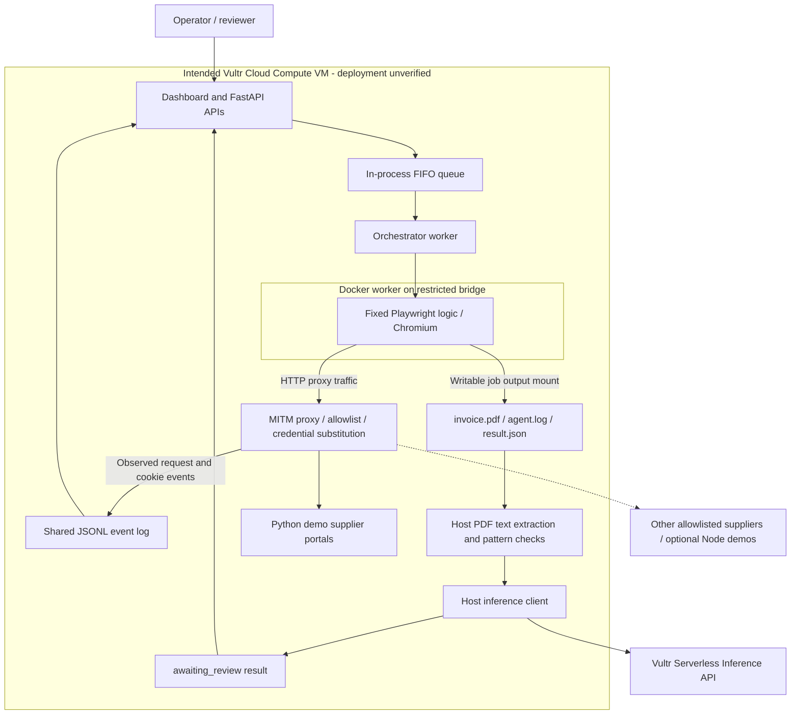

# Portal Courier

**Retrieve supplier invoices through a browser, extract invoice fields, and put the result in front of a human reviewer.**

Portal Courier is a hackathon prototype for accounts-payable teams that collect invoices from supplier websites. It combines deterministic Playwright automation, a credential-injecting HTTP proxy, PDF text extraction, Vultr Serverless Inference, and an approval dashboard. Its intended deployment puts disposable browser workers behind a restricted network on a Vultr Cloud Compute VM.

Built for **Vultr: Agent Rush Hackathon 2026 — Challenge 1: Blast Radius Zero**. The containment design is implemented in scripts and integration code; successful Docker/firewall containment and a public Vultr deployment are **not established by the supplied evidence**.

[Agent guide](agent/AGENT.md) · [Orchestrator guide](orchestrator/ORCHESTRATOR.md) · [Proxy guide](proxy/PROXY.md) · [Portal guide](portals/PORTALS.md) · [Deployment runbook](docs/DEPLOYMENT.md)

## Contents

- [Overview and business value](#overview-and-business-value)
- [Implementation and evidence status](#implementation-and-evidence-status)
- [Architecture](#architecture)
- [End-to-end workflow](#end-to-end-workflow)
- [Technology stack](#technology-stack)
- [Repository structure](#repository-structure)
- [Getting started](#getting-started)
- [Configuration](#configuration)
- [Run the local services](#run-the-local-services)
- [Submit and review an invoice job](#submit-and-review-an-invoice-job)
- [Docker and network isolation](#docker-and-network-isolation)
- [Vultr integration and public deployment](#vultr-integration-and-public-deployment)
- [Demonstration portals](#demonstration-portals)
- [Browser automation and invoice processing](#browser-automation-and-invoice-processing)
- [Security controls and trust boundaries](#security-controls-and-trust-boundaries)
- [Human review and dashboard behavior](#human-review-and-dashboard-behavior)
- [API overview](#api-overview)
- [Testing and evidence collection](#testing-and-evidence-collection)
- [Measurement methodology](#measurement-methodology)
- [Known limitations](#known-limitations)
- [Troubleshooting](#troubleshooting)
- [Proposed roadmap](#proposed-roadmap)
- [Team and contributions](#team-and-contributions)
- [License status](#license-status)
- [Documentation](#documentation)
- [Before submitting the hackathon entry](#before-submitting-the-hackathon-entry)

## Overview and business value

Finance staff often retrieve invoices from several supplier websites, sign in separately, download documents, and copy invoice details into a review process. Repeated browser work takes attention away from checking the documents themselves. Supplier-controlled pages and PDFs also introduce an additional trust boundary when automation processes their content.

Portal Courier proposes a controlled retrieval-and-review workflow:

1. An operator selects a configured supplier.
2. A browser worker signs in and downloads one invoice.
3. The host extracts PDF text and asks the configured inference model for the vendor, amount, and invoice number.
4. A small rule-based check flags certain instruction-like text.
5. A person reviews the original PDF, extracted fields, and available proxy events, then approves or rejects the result.

The target users are accounts-payable operators, finance teams, and developers evaluating browser automation against untrusted supplier content. The potential value is less repetitive retrieval and a consistent review surface. Time savings, extraction accuracy, operational cost, and improvements over manual work or RPA have **not been measured here**.

The distinguishing design choice is to keep supplier credentials and inference access on the host side while restricting the browser worker's network access in the intended Docker deployment. The browser workflow itself is fixed code: there is no autonomous LLM planning, visual reasoning, or general-purpose agent tool loop.

## Implementation and evidence status

“Implemented” below means that the behavior exists in the current source. It does not establish that a deployment or security guarantee has been verified.

| Area | Current implementation | Evidence and limits |
| --- | --- | --- |
| Browser retrieval | Headless Chromium signs in and saves one PDF using fixed Playwright selectors and heuristics. | Designed around the Python demo portals; no general supplier compatibility suite. |
| Orchestration | FastAPI, a single in-process FIFO worker, local/Docker runners, persisted job results, review APIs. | Local subprocess pipeline testing is reported in the deployment guide; no populated orchestrator test suite or CI evidence is supplied. |
| Extraction | Host-side `pdfplumber` plus an HTTP request to the configured Vultr-compatible chat-completions endpoint. | Mock inference is available. Live Vultr model execution and extraction quality need separate verification. |
| Injection flagging | Three case-insensitive text patterns produce a flag and an evidence quote. | A narrow heuristic; no comprehensive prompt-injection detection or PDF sanitization. |
| Credential/cookie proxy | Exact host-and-port allowlist, form password substitution, host-keyed storage of the `session` cookie. | Shared sessions and incomplete cookie semantics limit isolation. |
| Dashboard | Real API polling, job creation, PDF review, approval/rejection, event display. | Unauthenticated. The separate static mockup contains simulated data. |
| Docker/network controls | Agent image, resource limits, capability restrictions, bridge/firewall setup and probe scripts. | Actual enforcement, persistence, IPv6 coverage, and containment results remain unverified. |
| Supplier simulations | Two Python portals and six Node.js portal entries. | Eight simulations do not establish eight working agent integrations. |
| Public deployment/submission | A Vultr VM runbook and inference client configuration exist. | No verified public application URL, submitted demo video, benchmark report, or deployment evidence is supplied. |

See the component guides for source-level contracts. The [deployment guide](docs/DEPLOYMENT.md) distinguishes reported local testing from unexecuted infrastructure steps.

## Architecture

The diagram shows the **intended Docker deployment**. Local mode runs the agent directly on the host and does not provide the depicted container/network boundary.



| Component | Responsibility | Integration boundary |
| --- | --- | --- |
| [Agent](agent/AGENT.md) | Open a portal, fill a login form, find a download trigger, save a PDF, report a process exit code. | Receives a generated environment and an output directory; no inference API key is intentionally passed. |
| [Orchestrator](orchestrator/ORCHESTRATOR.md) | Resolve portals, queue jobs, launch workers, parse PDFs, call inference, persist results, expose APIs. | Trusted host process with filesystem access and, in Docker mode, Docker daemon access. |
| [Proxy](proxy/PROXY.md) | Filter observed destinations, substitute a dummy form password, retain/replay selected session cookies, emit events. | A shared, unauthenticated proxy process; its in-memory session map is not partitioned by job. |
| [Supplier portals](portals/PORTALS.md) | Supply controlled benign and hostile test pages and invoices. | Untrusted browser/PDF content. Hostile pages contain actual external-request attempts. |
| [Dashboard](orchestrator/static/index.html) | Start jobs and present review information. | Same-origin API client polling every 1.5 seconds; no authentication or server push. |
| [Infrastructure scripts](agent/docker-infrastructure/) | Create a Docker bridge and IPv4 firewall policy, launch a generic container, probe selected paths. | Host-administrator operations, separate from application startup. |

The proxy only controls traffic routed through it. Preventing a worker from bypassing it depends on correctly installed and verified host networking rules.

## End-to-end workflow

| Step | What actually happens |
| --- | --- |
| 1. Request | `POST /jobs` accepts portal objects. The orchestrator resolves registry values and permitted overrides. |
| 2. Queue | Jobs enter an unbounded, in-memory FIFO queue. One worker executes them sequentially in each application process. |
| 3. Launch | Local mode starts `agent/agent.py` as a subprocess; Docker mode creates the configured agent container. |
| 4. Login | The agent submits the dummy password. A matching proxy form request can be rewritten to contain the supplier password. |
| 5. Download | The agent selects one download trigger and saves `invoice.pdf`. It checks only the first four bytes for `%PDF`. |
| 6. Collect | The orchestrator captures stderr as `agent.log` and snapshots proxy events using a timestamp window. |
| 7. Analyze | The host extracts text from all PDF pages, scans it for three patterns, and attempts structured field extraction. |
| 8. Review | After successful PDF parsing, the result reaches `awaiting_review` even if inference fails. Suspicion and extraction failure are separate flags. |
| 9. Decide | The operator approves or rejects through the API/dashboard. The decision is persisted; no payment or supplier update occurs. |

```text
queued -> running -> awaiting_review -> approved
                                    -> rejected
                 -> failed
```

While `running`, phases may be `logging_in`, `downloading`, or `analyzing`. Agent failure or a missing downloaded PDF produces `failed`. A flagged PDF does not automatically fail or terminate the job. The worker proceeds to the next queued job without waiting for a review decision.

Result files survive a restart; the queue does not. Startup marks previously queued/running results as interrupted failures in memory, without resuming them or saving that startup change back to disk.

## Technology stack

Versions below come from the supplied dependency files, not from a verified deployment inventory.

| Technology | Declared version | Use |
| --- | --- | --- |
| Python | No project-wide interpreter pin | Application, agent, supplier portals, scripts. Python 3.11+ is a practical setup baseline, not a declared compatibility guarantee. |
| FastAPI / Uvicorn | `0.115.0` / `0.30.6` | Orchestrator and Python supplier HTTP services. |
| Playwright | `1.49.0` | Synchronous Chromium automation. Agent image: `mcr.microsoft.com/playwright/python:v1.49.0-noble`. |
| Jinja2 / python-multipart | `3.1.4` / `0.0.9` | Python portal templates and forms. |
| ReportLab / pdfplumber | `4.2.2` / `0.11.4` | Demo PDF generation / host PDF text extraction. |
| HTTPX | `0.27.2` | Inference HTTP requests and smoke-test client. |
| Docker Python SDK | `7.1.0` | Container creation and lifecycle management. |
| python-dotenv | `1.0.1` | Root `.env` loading by the orchestrator. |
| mitmproxy | Not pinned in the repository | Proxy addon runtime; install separately. |
| Express / Node.js | `^5.3.0`; lockfile resolves `5.3.0` / Express requires Node >=18 | Optional six-entry portal server. |
| HTML, JavaScript, Tailwind CDN | No frontend build manifest | Dashboard UI; external fonts/CDN assets require browser connectivity. |

`beautifulsoup4==4.12.3` and `openai==1.55.3` are also declared in [requirements.txt](requirements.txt); the current browser/inference path does not use them. The inference implementation uses HTTPX directly.

## Repository structure

This is a condensed view of existing paths; package markers, templates, and styles are grouped rather than exhaustively listed.

```text
portal-courier-main/
├── README.md
├── .env.example
├── requirements.txt
├── agent/
│   ├── AGENT.md
│   ├── agent.py
│   ├── Dockerfile
│   ├── requirements.txt
│   └── docker-infrastructure/
│       ├── deploy-zerotrust-network.sh
│       ├── run-playwright-container.sh
│       └── verify-zerotrust.sh
├── orchestrator/
│   ├── ORCHESTRATOR.md
│   ├── app/main.py
│   ├── portals.json
│   ├── static/
│   │   ├── index.html
│   │   ├── review.html
│   │   └── dashboard-mockup.html
│   └── tests/__init__.py
├── proxy/
│   ├── PROXY.md
│   ├── addon.py
│   ├── test_login.py
│   ├── test_hostile.py
│   └── test_node_browser.py
├── portals/
│   ├── PORTALS.md
│   ├── good/
│   │   ├── app.py
│   │   ├── run.ps1
│   │   ├── templates/
│   │   └── static/
│   ├── hostile/
│   │   ├── app.py
│   │   ├── templates/
│   │   └── static/
│   └── node-portals/
│       ├── server.js
│       ├── package.json
│       ├── package-lock.json
│       └── start.bat
├── scripts/
│   ├── mock_vultr.py
│   └── smoke_test.py
├── docs/
│   ├── DEPLOYMENT.md
│   └── README.md
└── testdata/
    └── README.md
```

`docs/README.md` and `testdata/README.md` are empty placeholders. There is no populated orchestrator test suite, measurements document, bundled invoice fixture set, or `LICENSE` file. Runtime `jobs/` and `events.jsonl` are created by execution, not supplied as evidence.

## Getting started

The smallest application setup needs Python, Chromium installed through Playwright, mitmproxy, and four service processes: two Python portals, the proxy, and the orchestrator. Node.js is optional. Docker mode additionally needs a Linux host, Docker Engine, and administrator access for networking rules.

The following commands are setup instructions; they are not a record of successful execution in this documentation review.

### Install the application

Run from the repository root. If using a downloaded archive, start at the virtual-environment commands.

```bash
git clone https://github.com/shinysonik/portal-courier.git
cd portal-courier
python3 -m venv .venv
source .venv/bin/activate
python -m pip install -r requirements.txt
python -m playwright install chromium
```

On Linux, install required browser system libraries where necessary with `python -m playwright install-deps chromium`. This can require administrator privileges. Docker workers use the browser image instead.

PowerShell activation alternative:

```powershell
py -m venv .venv
.\.venv\Scripts\Activate.ps1
python -m pip install -r requirements.txt
python -m playwright install chromium
```

Install mitmproxy in a separate environment, for example with an existing `pipx` installation:

```bash
pipx install mitmproxy
```

The repository does not pin mitmproxy or declare a tested mitmproxy/application dependency combination. Keep it separate from the application environment and record the version used. The proxy HTTP test scripts also need `requests`, which is not explicitly declared in the root requirements; see the [proxy testing instructions](proxy/PROXY.md#how-to-test-the-proxy).

## Configuration

Create a private `.env` in the repository root. A minimal **local-mode** configuration is:

```dotenv
RUNNER=local
PROXY_URL=http://127.0.0.1:8888
PORTAL_HOST=127.0.0.1
VULTR_BASE_URL=https://api.vultrinference.com/v1
VULTR_API_KEY=
VULTR_MODEL=
```

Set the API key privately and choose a model supported by your inference account to enable extraction. Blank key/model values skip the API call, set `extraction_failed`, and still allow a downloaded invoice to reach review. Do not treat an example value in [.env.example](.env.example) as an issued credential or publish private environment files.

### Orchestrator environment

The orchestrator loads root `.env` at import; existing process environment values take precedence. Restart it to change these settings.

| Variable | Default / meaning |
| --- | --- |
| `RUNNER` | `docker`. Only exactly `docker` after lowercasing selects Docker; every other value selects local mode. |
| `PROXY_URL` | Empty. When set, passed to the agent as `HTTP_PROXY` and `HTTPS_PROXY`. |
| `PORTAL_HOST` | `host.docker.internal` for Docker without a named network; otherwise `127.0.0.1`. Replaces `{host}` in registry URLs. |
| `OUT_ROOT` | Repository `jobs/`, resolved to an absolute path. |
| `EVENTS_PATH` | Repository `events.jsonl`. A relative override is relative to the process working directory. |
| `PORTALS_FILE` | Repository `orchestrator/portals.json`. Relative overrides use the working directory. |
| `AGENT_IMAGE` | `portal-courier-agent`. |
| `DOCKER_NETWORK` | Empty; set `playwright-net` for the supplied restricted-bridge setup. |
| `DOCKER_HARDEN` | `1`; exactly `0` disables the capability-drop and no-new-privileges options. |
| `VULTR_API_KEY` | Empty; host-side inference bearer credential. |
| `VULTR_BASE_URL` | `https://api.vultrinference.com/v1`. |
| `VULTR_MODEL` | Empty; no default model, discovery, or fallback. |

The portal registry defaults to `good` and `hostile`. It supplies URL, kind, username, and optional VAT identifier. The API also accepts custom portal values and overrides, including URLs; registry membership is not a URL security policy.

### Proxy and supplier configuration

The proxy and Python portals **do not load root `.env`**. Configure their process environments separately. The proxy reads `ALLOWED_HOSTS`, `REAL_USERNAME`, `REAL_PASSWORD`, `DUMMY_PASSWORD`, and `EVENTS_PATH`. `REAL_USERNAME` is currently unused by the addon: it changes only the password.

The Python portals read matching demo authentication settings, including `REAL_USERNAME`, `REAL_PASSWORD`, `DUMMY_PASSWORD` and `ALLOW_DUMMY`; the hostile portal additionally reads `REAL_NIP`. Keep password values consistent between suppliers and proxy. Use only isolated demo credentials; current source defaults are fixtures, not production secret management.

The orchestrator generates the agent's `PORTAL_URL`, `OUT_DIR`, `USERNAME`, `DUMMY_PASSWORD`, `PORTAL_KIND`, and optional `VAT_ID`. The dummy password is currently fixed by the orchestrator, so changing only the proxy's placeholder creates a mismatch. See the component guides for complete defaults and direct-agent execution.

## Run the local services

Use separate terminals, all starting in the repository root. Activate the application virtual environment in the portal/orchestrator terminals. These local commands provide an application integration path, **not network containment**.

### 1. Python supplier portals

Terminal 1:

```bash
python -m uvicorn portals.good.app:app --host 127.0.0.1 --port 5001
```

Terminal 2:

```bash
python -m uvicorn portals.hostile.app:app --host 127.0.0.1 --port 5002
```

The hostile server can be started without visiting its attack-bearing pages. Do not run its browser scenario until the intended test environment's egress controls have been verified.

### 2. Proxy

Terminal 3, Bash:

```bash
export ALLOWED_HOSTS=localhost:5001,localhost:5002,127.0.0.1:5001,127.0.0.1:5002
export EVENTS_PATH="$PWD/events.jsonl"
mitmdump --listen-host 127.0.0.1 --listen-port 8888 -s proxy/addon.py
```

PowerShell equivalent:

```powershell
$env:ALLOWED_HOSTS = 'localhost:5001,localhost:5002,127.0.0.1:5001,127.0.0.1:5002'
$env:EVENTS_PATH = Join-Path $PWD 'events.jsonl'
mitmdump --listen-host 127.0.0.1 --listen-port 8888 -s proxy/addon.py
```

Exact host **and port** must match. These explicit values cover both Python portals; optional Node demos require an additional matching host/port. Run proxy and orchestrator against the same event file. No proxy DNS server is supplied.

### 3. Orchestrator and browser agent

Terminal 4, with the local `.env` above:

```bash
python -m uvicorn orchestrator.app.main:app --host 127.0.0.1 --port 8000
```

Use one application process. Multiple workers each create their own queue and worker thread. Avoid development reload while jobs are active.

The orchestrator starts the browser agent on demand; it is not a separate HTTP service. For direct agent commands and exit-code details, use [the agent execution guide](agent/AGENT.md).

Open the [local dashboard](http://127.0.0.1:8000/), [review page](http://127.0.0.1:8000/review), or [API explorer](http://127.0.0.1:8000/docs). The dashboard's **Start** action queues both registered portals, including the hostile one. Begin with the benign API request below when checking local setup.

## Submit and review an invoice job

Bash examples; PowerShell users can use `curl.exe` rather than the `curl` alias.

```bash
curl -sS http://127.0.0.1:8000/health
curl -sS -X POST http://127.0.0.1:8000/jobs \
  -H 'Content-Type: application/json' \
  -d '{"portals":[{"portal_id":"good"}]}'
curl -sS http://127.0.0.1:8000/jobs
```

The request contains **portal objects**, not a list of URL strings. Creation returns HTTP 200 with an array of job objects; the worker may already have advanced a job's status. HTTP 200 does not establish successful login, download, extraction, or containment.

Copy a returned job ID into the variable below:

```bash
JOB_ID='replace-with-returned-job-id'
curl -sS "http://127.0.0.1:8000/jobs/$JOB_ID"
curl -sS "http://127.0.0.1:8000/events?job_id=$JOB_ID"
```

View `/jobs/{job_id}/pdf` in the dashboard, inspect the fields, extraction failure flag, suspicious text quote, and events, then choose one decision **only after the job reaches `awaiting_review`**:

```bash
curl -sS -X POST "http://127.0.0.1:8000/jobs/$JOB_ID/approve" \
  -H 'Content-Type: application/json' \
  -d '{"comment":"Reviewed the original document and extracted fields."}'
```

To reject a different awaiting-review result, use `/reject` with the same optional `comment` body shape. Decisions are review records, not financial authorization or downstream payment execution.

## Docker and network isolation

This is a **deployment procedure to validate on a prepared Linux host**, not a tested containment result. The network script changes host Docker networking, IPv4 firewall rules, and persistence configuration. Read it before running it on a disposable test VM.

Build the actual agent image from the repository root:

```bash
docker build -t portal-courier-agent -f agent/Dockerfile .
```

Provision the supplied network as an administrator:

```bash
sudo bash agent/docker-infrastructure/deploy-zerotrust-network.sh
```

Its defaults are `playwright-net`, bridge `br-playwright`, subnet `172.28.0.0/16`, gateway `172.28.0.1`, and proxy port `8888`. The intended IPv4 policy permits the bridge-to-host proxy port and drops other host/forwarded worker traffic, including direct DNS. It supplies no DNS resolver. Existing networks are reused without full configuration validation, and no IPv6 containment rules are installed.

Run the host proxy listening on `172.28.0.1:8888` instead of loopback. Its allowlist should still match the supplier destinations, such as `127.0.0.1:5001` and `127.0.0.1:5002`: the proxy, not the container, connects to those host-loopback services.

Use these orchestrator settings:

```dotenv
RUNNER=docker
AGENT_IMAGE=portal-courier-agent
DOCKER_NETWORK=playwright-net
DOCKER_HARDEN=1
PROXY_URL=http://172.28.0.1:8888
PORTAL_HOST=127.0.0.1
```

The orchestrator mounts each job directory at `/out`, sets 1 GiB memory, one CPU, 256 PIDs, and 512 MiB shared memory, and applies `cap_drop=ALL` plus no-new-privileges unless disabled. Named-network workers receive `127.0.0.1` as DNS configuration. These are requested Docker settings; successful enforcement still needs inspection and runtime tests.

The image runs as root with a writable root filesystem, and Chromium uses `--no-sandbox`. The agent container's polling deadline is 70 seconds after creation, not a bound on all Docker API calls or subsequent PDF/inference processing.

Probe a worker on the bridge using the supplied verifier, for example:

```bash
docker run --rm --network playwright-net --dns 127.0.0.1 \
  --cap-drop ALL --security-opt no-new-privileges \
  -v "$PWD/agent/docker-infrastructure/verify-zerotrust.sh:/verify-zerotrust.sh:ro" \
  portal-courier-agent bash /verify-zerotrust.sh
```

Inspect **all four outcomes**, not just the exit status. The script checks direct WAN TCP, TCP DNS, host SSH, and proxy reachability. A failed proxy-reachability check currently warns without incrementing the failure counter; exit 0 can therefore accompany only three successful expectations. It does not measure bytes, test UDP DNS or IPv6, or prove credential non-disclosure.

The generic [container launcher](agent/docker-infrastructure/run-playwright-container.sh) is separate from the orchestrator's Docker runner and has different defaults, including `--ipc=host`. Do not infer identical restrictions. Docker Desktop and the script's Podman branch need separate verification. Follow the [deployment runbook](docs/DEPLOYMENT.md) for service setup and firewall context.

## Vultr integration and public deployment

Vultr Cloud Compute is the intended host for the central orchestrator, dashboard, proxy, demo suppliers, browser containers, and host firewall. This architecture needs backend processes and administrator-managed networking; static-site hosting alone cannot run it.

Vultr Serverless Inference is used **after download**, from the host. The client posts to `VULTR_BASE_URL/chat/completions` with `VULTR_MODEL` and the bearer key. It sends up to 8,000 characters of extracted PDF text, temperature 0, and `max_tokens=400`, requesting `vendor`, `amount`, and `invoice_number`. There are at most two immediate attempts, each using a 45-second HTTPX timeout. There is no model fallback, model discovery, vision verification, or full-job analysis deadline.

The [official challenge page](https://lablab.build/ai-hackathons/vultr-hackathon?track=c1-blast-radius-zero) describes a Vultr-hosted backend, inference integration, and isolated agent execution. Portal Courier supplies the central queue, browser runner, review interface, inference client, and proposed containment infrastructure. Its fixed browser logic does not implement the reference pattern's LLM planning or screenshot-based verification. Final compliance and deployment evidence require human review against the event rules.

Use [docs/DEPLOYMENT.md](docs/DEPLOYMENT.md) for the intended Ubuntu VM installation, bridge setup, and systemd services. That runbook reports local subprocess pipeline testing; Docker, firewall, systemd, persistence, and live public deployment steps remain unverified.

Before exposing the application, provide deployment-level authentication, TLS, and access restrictions. The application and proxy have no authentication. The runbook's `0.0.0.0` API binding is not an access-control mechanism, and membership in the Docker group gives substantial host privileges. No verified public URL is supplied in this repository.

## Demonstration portals

| Implementation | Inventory | Downloads and agent compatibility |
| --- | --- | --- |
| Python `portals/good` | EnergoPlus, default port 5001; five fixed invoices. | PDFs; registered as `good`. First visible download is the October 2026 fixture. |
| Python `portals/hostile` | GazSfera, default port 5002; two fixed invoices. | PDFs; registered as `hostile`. The agent's fallback selects October 2026. |
| Node `portals/node-portals` | Six entries under one Express server, default port 3000. | Two TXT, two CSV, one HTML, one PDF. Not registered in the default orchestrator configuration. |

The Python portals implement demo CSRF checks, credential validation, in-memory sessions, and an HttpOnly `session` cookie. They expose invoice metadata APIs, but the agent uses browser interactions. The Node portals use `user`/`pass` fields and accept submissions without genuine authentication or protected sessions.

Optional Node server:

```bash
cd portals/node-portals
npm ci
npm start
```

Run this in a separate terminal. The server may retry port 3001 after a collision, which does not update proxy allowlists or test URLs. See the [portal inventory and routes](portals/PORTALS.md) for all six names and formats.

Use these scenarios as experiments, not pre-established results:

- **Benign retrieval:** queue `good` and inspect the original PDF and extracted values. The first fixture has a gross amount of 1,045.50 EUR; verify extraction rather than assuming the model chose gross instead of net.
- **Hostile content:** after validating containment, queue `hostile`. Its invoice-list page attempts external requests through fetch, an image, a direct-IP request, and beacon logic. Its PDFs contain instruction-like text and a phishing link.
- **Continuation:** after a hostile result, queue a benign job and inspect it independently. Queue progression is implemented; successful recovery and session independence are not proven by UI wording.
- **Format boundary:** Node TXT/CSV/HTML attachments exercise unsupported inputs. The agent's PDF header check rejects them; their existence is not multi-format pipeline support.

The HTTP-only hostile test does not execute JavaScript. Five scripted attack mechanisms do not establish five observed blocks or zero leaked bytes. The [static dashboard mockup](orchestrator/static/dashboard-mockup.html) uses simulated portal data and containment figures and is not application telemetry.

## Browser automation and invoice processing

The current agent fills a recognized login form, waits for a login signal, and selects the first matching invoice/download trigger. It may fall back to a year/month filter fixed at **2026/10**. It automatically accepts JavaScript dialogs after attaching its handler. It downloads one file per job, with no general invoice selection, date-range retrieval, pagination, or multi-document batch extraction.

The browser's intended time budget is 60 seconds, with a 63-second watchdog. The orchestrator adds a 70-second subprocess/container wait. These values do not cap host PDF parsing or both inference attempts. Agent exits are 0 success, 1 login failure, 2 download failure, 3 timeout/proxy unreachable, and 10 configuration/unknown error; several Playwright timeouts map to download failure. See [agent error handling](agent/AGENT.md) for the exact caveats.

PDF text extraction runs on the host over all pages. There is no OCR, attachment sanitization, malware scanner, link removal, or resource-isolated parser. The inference response is parsed for three keys and values are loosely converted to strings; there is no validated amount/currency schema, purchase-order matching, accounting integration, or ground-truth accuracy check.

## Security controls and trust boundaries

| Implemented control | What it covers | Limitation |
| --- | --- | --- |
| Proxy destination allowlist | Exact `host:port` matching in request and CONNECT hooks; denied destinations receive HTTP 403. | Not IP pinning or per-job authorization. Bypass prevention requires independent network enforcement. |
| Password substitution | Allowed URL-encoded `POST /login` with a matching dummy `password` field is rewritten before forwarding. | No JSON/nested-login support, per-supplier password map, or response reflection filtering. Username is unchanged. |
| Session retention | Cookies named exactly `session` are removed from responses, stored by host/port, and reattached upstream. | Other cookies pass through. Stored sessions are shared across clients/jobs and lack browser-equivalent expiry/path semantics. |
| Agent environment construction | An explicit environment is generated; local inherited sensitive-looking names are filtered. | A naming filter is not a general secret-isolation boundary. Host processes, proxy memory, and allowed upstream requests still handle sensitive data. |
| Docker restrictions | Requested memory/CPU/PID bounds, dropped capabilities, no-new-privileges, named network. | Root worker, writable output/root filesystem, disabled Chromium sandbox, and unverified infrastructure enforcement. |
| Injection checks | Case-insensitive line matching for `SYSTEM OVERRIDE`, `Ignore all previous instructions`, and `attacker.example`. | Absence of those strings does not establish safety. The check flags text; it does not sanitize the PDF or guarantee model behavior. |
| Human review | Stores approval/rejection after download and analysis. | No reviewer authentication, enforced separation of duties, immutable record, or payment workflow. |

A fresh browser/container does **not** reset the proxy's sessions. Retained supplier sessions can redirect a later login page before the agent finds a password field, causing repeat-run failures. Restarting a development proxy while idle clears its in-memory map; this is a workaround, not per-job isolation.

The browser ignores certificate errors in proxy mode. Supplier JavaScript and redirects execute, and the agent has no independent URL policy. An allowed supplier can still receive data or perform authenticated actions. Hostile PDF text is sent to the configured inference service; operators must account for document sensitivity.

Audit snapshots and job files are mutable, and the agent's whole job output directory is writable. The host trusts these artifacts for parsing and review without a hardened artifact-validation boundary. The design does not establish complete credential isolation, zero-byte exfiltration, immutable audit evidence, compliance certification, or automatic worker destruction on the first blocked request.

## Human review and dashboard behavior

The live dashboard at `/` polls portals, jobs, and events every 1.5 seconds. `/review` is a simpler review client using the same APIs. Neither is a WebSocket or a live stream of agent stdout.

A result can be approved when `suspicious=true` or `extraction_failed=true`. The main dashboard adds a browser confirmation for suspicious results, but the backend does not require that confirmation or a comment. Decision endpoints require `awaiting_review`; the precondition and update are not atomic, so concurrent decisions can race.

The displayed “cookie held” count reflects `COOKIE_STRIPPED` events, not a session inventory. A “clean” label means no configured text pattern matched. Dashboard counts and “next portal not affected” wording do not independently prove correctness or containment.

## API overview

All application routes are defined in [orchestrator/app/main.py](orchestrator/app/main.py). Successful POSTs return HTTP 200.

| Method | Route | Purpose |
| --- | --- | --- |
| GET | `/` | Main dashboard. |
| GET | `/review` | Minimal review page. |
| GET | `/health` | Process configuration summary and queue size; not supplier/proxy/model readiness. |
| GET | `/portals` | Registry summaries and last-job status. |
| POST | `/jobs` | Validate portal objects and queue jobs. |
| GET | `/jobs` | List all jobs, oldest first, without pagination. |
| GET | `/jobs/{job_id}` | Job details and selected proxy events. |
| GET | `/jobs/{job_id}/pdf` | Serve the existing original PDF inline. |
| POST | `/jobs/{job_id}/approve` | Approve an awaiting-review result, with optional comment. |
| POST | `/jobs/{job_id}/reject` | Reject an awaiting-review result, with optional comment. |
| GET | `/events` | Shared events, or a job selection with `?job_id=...`. |

FastAPI also supplies its default OpenAPI/docs routes. See the [full API reference](orchestrator/ORCHESTRATOR.md) for request/response examples and error contracts.

Typical errors are HTTP 400 for invalid portal selections, 404 for unknown jobs or absent PDFs, 409 for an invalid decision state, and 422 for request validation. Unhandled failures can return 500. Agent/inference failures after creation appear in job results rather than changing the original creation response. There are no cancel, retry, payment, upload, or portal-management endpoints.

## Testing and evidence collection

The table describes available scripts, not a passing test report. No application, browser, Docker, firewall, or live inference test was executed as part of this README-only update.

| Script / area | Procedure and scope | Evidence limits |
| --- | --- | --- |
| `proxy/test_login.py` | `python proxy/test_login.py` with proxy on 8888 and good portal on 5001. | Requests-based login/session path; no explicit assertion that the client received no session cookie. Existing proxy sessions can affect it. |
| `proxy/test_hostile.py` | `python proxy/test_hostile.py` with proxy and hostile portal on 5002. | HTTP login, invoice list, and PDF retrieval only; no supplier JavaScript execution. Writes `hostile_invoice.pdf`. |
| `proxy/test_node_browser.py` | See [proxy verification](proxy/PROXY.md#how-to-test-the-proxy). | Current selectors use `username`/`password` while Node forms use `user`/`pass`. The flow is not a reliable passing browser test. |
| `scripts/smoke_test.py` | `python scripts/smoke_test.py` against local API on 8000, in a verified hostile-test environment. | Queues good then hostile; polls without an overall deadline or strong outcome assertions. `--decide` automatically decides and is not human review. |
| `scripts/mock_vultr.py` | Run `python -m uvicorn scripts.mock_vultr:app --host 127.0.0.1 --port 9000`. Point the host client at `http://127.0.0.1:9000/v1` with non-secret test key/model values. | Tests a compatible endpoint shape, not Vultr. `MOCK_FAIL=1` on the mock server exercises HTTP 500 failures. Regex-derived fields are not a correctness oracle. |
| `verify-zerotrust.sh` | Run inside the intended worker network, as above. | Four selected connectivity checks; proxy-check exit-code defect and incomplete protocol coverage. |
| `orchestrator/tests/` | Contains only `__init__.py`. | No automated application tests are implemented there. |

For hostile browser tests, validate the environment first and use controlled evidence collection. Reset demo proxy sessions between independent scenarios while no job is active. Read each script's implementation rather than relying on stale script comments or a successful shell exit alone.

### Runtime artifacts

Default per-job files live under `jobs/{job_id}/`:

| Artifact | Meaning |
| --- | --- |
| `invoice.pdf` | Original downloaded attachment, retained for review. |
| `agent.log` | Captured agent stderr; not a complete host/proxy log. |
| `debug.png` | Best-effort screenshot on selected failures; not guaranteed. |
| `events.json` | Snapshot selected from the shared proxy event log. |
| `result.json` | Persisted job fields, status, portal information, extraction, and decision. |
| Root `events.jsonl` | Shared proxy JSONL events, with UTC timestamps and event-specific metadata. |

Proxy events include `REQUEST_ALLOWED`, `BLOCKED`, `CREDENTIAL_INJECTED`, `CREDENTIAL_NOT_INJECTED`, `COOKIE_REATTACHED`, `COOKIE_STRIPPED`, and `COOKIE_PASSED`. They intentionally omit password values, but paths/query strings, usernames, PDFs, screenshots, and result metadata can still be sensitive.

Events have no job/container correlation ID. The orchestrator waits 1.2 seconds after the agent and selects a timestamp window, which can include unrelated traffic; an existing job snapshot is reused. These files are not immutable audit records or byte counters. Preserve redacted evidence separately with run identifiers, versions, configuration, and timestamps before making verification claims.

## Measurement methodology

No benchmark dataset or results are supplied. Use a repeatable, documented experiment before reporting performance, accuracy, cost, or containment.

| Question | Suggested measurement | Interpretation constraint |
| --- | --- | --- |
| Is retrieval faster than manual work? | Use the same portals/documents, defined start/end events, repeated runs, and a recorded manual baseline. Report median and spread. | Do not turn one successful demo into a time-savings claim. |
| How long does each stage take? | Record request, launch, download, parsing, inference, and decision timestamps separately. | `agent_finished` includes collection delay; reported successful inference latency covers only the last successful attempt. |
| Are fields correct? | Compare vendor, gross amount/currency, and invoice number against reviewed fixture truth; record model/version and failures. | The mock endpoint may select a net amount or wrong fixture identity. |
| Does egress containment work? | Establish reachable baselines, test permitted/denied paths, inspect firewall/container state, and collect traffic or controlled sink observations. | A failed TCP connect or a BLOCKED log is not a zero-byte leak measurement. Include UDP DNS and IPv6 separately. |
| Do credentials remain outside the worker? | Use synthetic secrets and inspect worker environment, cookies, artifacts, and controlled request/response traces. | HttpOnly already hides Python portal session cookies from `document.cookie`; that alone does not prove proxy stripping. |
| What does a job cost? | Record actual VM allocation, run duration, inference usage/billing, model, and retry count. | No cost comparison is valid without dated prices and measured usage. |

Retain both failed and successful runs, including evidence that the proxy was reachable. Do not use the standalone mockup's “0 bytes” or containment percentages as measurements.

## Known limitations

- **Prototype reliability:** selectors and invoice selection target the demos; retained proxy sessions can break repeated logins. The two Python invoice-detail templates iterate `invoice.items` in a way that can resolve to the dictionary method and fail rendering; direct download paths bypass those pages.
- **Incomplete integrations:** Node TXT/CSV/HTML attachments are unsupported by the PDF pipeline; Node PDF integration is not established. The Node browser test has mismatched selectors. Its launcher references a missing `dashboard.html`, and package metadata is inconsistent.
- **Security enforcement:** no fail-closed startup requirement for Docker, proxy, named network, or hardening; a mistyped runner value selects local execution. The proxy is shared and unauthenticated, and no per-job session deletion is implemented.
- **Host exposure:** unauthenticated APIs accept URL overrides; the host parses untrusted PDFs without a resource sandbox. Writable job artifacts and event snapshots are trusted. No production-grade secret store, TLS/access-control layer, or immutable evidence store is included.
- **Lifecycle and scale:** in-memory queue, one worker per process, no bounded queue, cancellation, retry API, restart recovery, distributed coordination, or robust orphan reconciliation. Persistence failures can interrupt worker processing.
- **Analysis:** fixed pattern checks, no OCR, semantic invoice validation, PO matching, general autonomous planning, screenshot verification, or end-to-end analysis deadline.
- **Verification:** Docker/firewall persistence, IPv6 containment, live Vultr inference, public deployment, byte-level exfiltration prevention, and successful independent multi-portal recovery remain unverified.

The [component guides](#documentation) contain further source-level caveats. Infrastructure and deployment examples are procedures or expected checks, not proof that the intended controls have run successfully.

## Troubleshooting

| Symptom | Check |
| --- | --- |
| Browser executable missing | Activate the application environment and run `python -m playwright install chromium`; install Linux browser libraries where needed. |
| Connection refused / agent exit 3 | Confirm the proxy is listening at the address reachable from the worker. Container loopback is not host loopback. |
| Proxy returns 403 | Match the actual destination's exact host and port in `ALLOWED_HOSTS`; localhost and 127.0.0.1 are different entries. |
| Login fails after an earlier success | Retained proxy session may have bypassed the expected form. Clear it by restarting the idle development proxy; inspect portal/proxy settings. |
| Download failure / exit 2 | Inspect `agent.log` and optional `debug.png`, selectors, fixed date filter, browser timeouts, and the PDF header. TXT/CSV/HTML are unsupported. |
| `extraction_failed=true` | Confirm host key/model/base URL, inspect the recorded error, and distinguish mock availability from live Vultr service access. A reviewable PDF may still exist. |
| `/health` says OK but jobs fail | Health reports process/configuration state, not actual Docker, supplier, proxy, or inference readiness. |
| Empty or mixed job events | Ensure shared `EVENTS_PATH` and working directory agree; time-window selection is not job-level correlation. |
| Decision returns 409 | Only `awaiting_review` results can be decided; inspect current status. |
| API returns 400 or 422 | Submit `{"portals":[{"portal_id":"good"}]}` and check required resolved portal fields. |
| Docker worker cannot reach proxy | Inspect bridge/gateway, host listener, firewall rules, and all four verifier outcomes. Exit 0 alone is insufficient. |
| Node examples do not match browser test | Use actual `user`/`pass` fields and reported port; the supplied test requires correction before reliable verification. |

## Proposed roadmap

These are recommendations, not delivered features or a committed release schedule.

1. Fix repeated-login/session handling, portal detail rendering, test selectors, verifier exit status, and inconsistent launcher/package metadata.
2. Add meaningful integration tests, PDF fixture assertions, explicit job/event correlation, atomic review transitions, and reproducible evidence capture.
3. Require validated security prerequisites for contained mode; partition and expire proxy sessions; harden artifact handling and PDF parsing; add authentication and TLS at deployment boundaries.
4. Verify Docker/IPv4/IPv6 enforcement and restart persistence on Vultr, then publish redacted deployment evidence and a public demonstration.
5. Add durable queue/recovery, stricter extraction schemas, measured accuracy, and bounded parsing/inference.
6. Evaluate additional suppliers, OCR, formats, and richer agent planning only with corresponding policy controls and tests.

## Team and contributions

The live dashboard's About panel credits the following people. These are source-listed credits, not independently verified Git authorship or hackathon registration records.

| Name | Role stated in the dashboard |
| --- | --- |
| Sofia Shevelo | Captain; Team Lead & Architect |
| Zaid Sohail | No role specified |
| SK Aman Akmal | No role specified |
| Muhammad Umair | No role specified |
| Hassan Memon | No role specified |
| Talha Abid | No role specified |

Confirm names, roles, attribution, and submission membership with the team before publishing. No award or certification is asserted.

Contributors should read the relevant component guide, describe the intended change and its trust boundaries, and report precisely which checks were run. Include redacted reproduction steps for defects; keep keys, private environment files, real invoices, and sensitive runtime artifacts out of contributions. No dedicated contribution guide or contribution policy is currently supplied.

## License status

No `LICENSE` file is present, and an open-source license has not been established by this repository. Do not assume MIT or another license. The maintainers must choose and add an appropriate license, confirm dependency obligations, and review hackathon submission terms before presenting the project as licensed open source.

## Documentation

| Document | Scope |
| --- | --- |
| [agent/AGENT.md](agent/AGENT.md) | Browser workflow, environment, direct execution, exits, timeouts, and sandbox limitations. |
| [orchestrator/ORCHESTRATOR.md](orchestrator/ORCHESTRATOR.md) | Queue/runner behavior, all APIs, PDF/inference processing, dashboard, configuration, and persistence. |
| [proxy/PROXY.md](proxy/PROXY.md) | Request filtering, credential substitution, cookies, event formats, tests, and security limits. |
| [portals/PORTALS.md](portals/PORTALS.md) | Eight demo simulations, routes, formats, authentication, attacks, and compatibility issues. |
| [docs/DEPLOYMENT.md](docs/DEPLOYMENT.md) | Intended Vultr VM/service setup; distinguish reported local checks from unverified infrastructure steps. |
| [Infrastructure scripts](agent/docker-infrastructure/) | Actual bridge/firewall, launcher, and connectivity probe implementations. |
| [docs/README.md](docs/README.md) / [testdata/README.md](testdata/README.md) | Existing empty placeholders, not additional guides or evidence. |

If descriptions conflict, inspect the current source and component-specific caveats. Older wording about successful containment or a single inference call must not be treated as verified evidence; the current inference client can make two attempts.

## Before submitting the hackathon entry

- Verify team membership, event requirements, license choice, and the repository's final public contents.
- Run and record the benign and hostile browser workflows on the intended Vultr deployment, including an independently checked benign run afterward.
- Verify live inference with a supported model and reviewed field outputs; distinguish it from mock execution.
- Verify network restrictions, proxy reachability, session handling, Docker settings, and persistence; document remaining failures.
- Protect the public API/dashboard and proxy, publish a working application URL, and confirm it from outside the VM.
- Produce the required demonstration and architecture material with redacted runtime evidence. No video, slide deck, successful deployment, or benchmark is established by this README.
