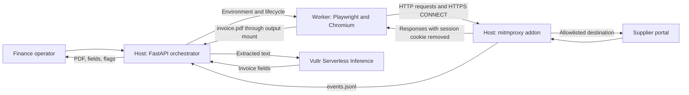

# Portal Courier Browser Agent

The browser agent is a short-lived Playwright worker that signs in to a supplier portal and saves **one PDF invoice per invocation**. The orchestrator can run it inside a disposable Docker container or as a local development subprocess.

The implementation in [`agent.py`](agent.py) uses fixed selectors and navigation rules. **It does not use autonomous LLM planning, vision, or model-generated browser actions.** PDF text extraction, prompt-injection detection, Vultr Serverless Inference calls, and human review belong to the host-side orchestrator.

## Contents

- [1. Overview and responsibilities](#1-overview-and-responsibilities)
- [2. Implemented features and verification status](#2-implemented-features-and-verification-status)
- [3. Architecture and component boundaries](#3-architecture-and-component-boundaries)
- [4. Browser execution workflow](#4-browser-execution-workflow)
- [5. Technology stack and dependencies](#5-technology-stack-and-dependencies)
- [6. Environment variables and configuration](#6-environment-variables-and-configuration)
- [7. Prerequisites and installation](#7-prerequisites-and-installation)
- [8. Local and Docker execution](#8-local-and-docker-execution)
- [9. Inputs, outputs, logs, and artifacts](#9-inputs-outputs-logs-and-artifacts)
- [10. Error handling, exit codes, and timeouts](#10-error-handling-exit-codes-and-timeouts)
- [11. Security model and limitations](#11-security-model-and-limitations)
- [12. Proxy and orchestrator integration](#12-proxy-and-orchestrator-integration)
- [13. Testing and verification](#13-testing-and-verification)
- [14. Troubleshooting](#14-troubleshooting)
- [15. Known limitations and unsupported features](#15-known-limitations-and-unsupported-features)
- [16. Related documentation and source](#16-related-documentation-and-source)

## 1. Overview and responsibilities

The worker automates the retrieval stage of an accounts-payable workflow: open a login page, submit a form, find an invoice download, and return a file and process status. It is designed around the two Python supplier simulations in this repository.

| Agent responsibility | Implementation |
|---|---|
| Read invocation settings | Process environment; no command-line configuration or `.env` loading |
| Start a browser | Headless Chromium through Playwright's synchronous Python API |
| Sign in | Username, placeholder password, and optional `nip` VAT field |
| Locate an invoice | Direct download link, or year/month picker followed by a download trigger |
| Capture the download | Playwright `expect_download()` and `save_as()` |
| Check the file | Verify that its first four bytes are `%PDF` |
| Report the outcome | Exit code, stderr log, optional invoice-ID JSON on stdout |
| Release browser resources | Attempt `browser.close()` in a `finally` block after browser creation |

The worker does not parse invoice fields, inspect PDF links, flag prompt injection, approve invoices, post to a ledger, or make payments. A successful worker exit means retrieval and the header check succeeded; it does not establish that the invoice is correct or safe.

## 2. Implemented features and verification status

| Capability | Status and scope |
|---|---|
| EnergoPlus direct-download workflow | Implemented in source; selects the first matching download trigger |
| GazSfera period-picker workflow | Implemented in source; selects October 2026 and accepts download dialogs |
| Proxy routing, including loopback URLs | Implemented when a proxy variable is supplied |
| PDF download and optional invoice ID | Implemented; PDF validation is a four-byte header check |
| Failure screenshots and elapsed-time logs | Implemented, with exceptions described below |
| Agent watchdog and orchestrator timeout | Implemented in separate processes |
| Docker image and restricted Docker runner | Implemented configuration; enforcement requires a working Docker host |
| Local integration testing | Reported by the existing deployment runbook; not independently reproduced by this documentation update |
| Static verification | Repository analysis parsed all Python files and checked isolated orchestrator helpers; this is not an agent end-to-end test |
| Docker, firewall, systemd, and live Vultr deployment | Not verified by this documentation update; the runbook explicitly records its infrastructure steps as unrun |
| Autonomous planning, vision verification, and multi-format ingestion | Not implemented |

There is no dedicated automated agent unit-test suite or committed agent integration-test report. Commands in this document are execution and verification procedures, not records of successful runs. See [testing and verification](#13-testing-and-verification).

## 3. Architecture and component boundaries



In Docker mode, the worker node above runs in a container. In local mode, it is a host subprocess and has no container isolation. The intended Linux network configuration restricts the container to a host proxy endpoint; neither the image nor the agent installs that policy.

| Component | Owns |
|---|---|
| [`agent.py`](agent.py) | Browser actions and file retrieval |
| [`Dockerfile`](Dockerfile) | Worker image containing the agent code and Playwright runtime |
| [Orchestrator](../orchestrator/app/main.py) | Registry resolution, queue, container/subprocess lifecycle, artifacts, PDF analysis, inference, review state |
| [Proxy addon](../proxy/addon.py) | Destination filtering, password substitution, selected cookie isolation, event logging |
| [Network setup script](docker-infrastructure/deploy-zerotrust-network.sh) | Host bridge and IPv4 firewall configuration |
| [Supplier simulations](../portals/PORTALS.md) | Login pages, invoice downloads, and synthetic attacks |

## 4. Browser execution workflow

1. **Validate configuration.** Require nonempty `PORTAL_URL`, `OUT_DIR`, `USERNAME`, and `DUMMY_PASSWORD`. Create `OUT_DIR`, including missing parent directories.
2. **Prepare proxy routing.** If configured, attempt a TCP connection to the proxy with a three-second timeout. This checks reachability, not HTTP forwarding or policy correctness.
3. **Launch Chromium.** Use headless mode and `--no-sandbox`. With a proxy, also set `--proxy-server`, `--proxy-bypass-list=<-loopback>`, and `--ignore-certificate-errors`.
4. **Create a fresh browser context.** Enable downloads and open one page. No stored browser profile or Playwright storage state is loaded.
5. **Open the login page.** Navigate to `PORTAL_URL`, waiting for `domcontentloaded`.
6. **Fill the form.** Select the first password input. Prefer `input[name="username"]`; otherwise use the first text input or input without a `type` attribute. Fill `input[name="nip"]` only when present and `VAT_ID` is provided. A required `nip` field without a value produces a login error.
7. **Submit and detect login.** Prefer a submit button/input, falling back to a button whose accessible name matches `sign in` or `log in`. Poll every 250 ms for up to 15 seconds. A URL no longer containing `/login` counts as success; otherwise, no password input may be visible and an invoice/download link or button must exist. A visible `.alert` with a visible password input on a login URL counts as rejection.
8. **Choose a download path.** Register a handler that accepts every subsequent JavaScript dialog. First search for download/PDF text in anchors, then buttons, then elements with `onclick`, then spans. Use the first match in the first matching selector category.
9. **Use the period picker if necessary.** If no direct trigger exists, require `select[name="year"]` and `select[name="month"]`, select `2026` and `10`, and click a button matching `Show invoices`. Wait for a visible download/PDF trigger instead of network idle.
10. **Capture one download.** Register `expect_download()` before clicking, save the download as `OUT_DIR/invoice.pdf`, and check its `%PDF` prefix. Derive an optional invoice ID from a download URL matching `/invoice/(.+?)/download`.
11. **Finish.** Attempt to close the browser. On success, print the invoice-ID JSON if one was found, log `done`, and exit `0`. The orchestrator then performs downstream analysis.

The login signal is a heuristic, not an independent authentication check. Download selection does not validate invoice date, payment status, supplier identity, or amount. The agent does not explicitly log out of the supplier portal.

## 5. Technology stack and dependencies

| Dependency | Version or source | Role |
|---|---|---|
| Python | Host instructions use Python 3.11+ | Agent runtime and standard-library configuration, sockets, timing, and logging |
| Playwright Python | `1.49.0` in [`requirements.txt`](requirements.txt) | Synchronous browser automation |
| Chromium | Browser revision associated with Playwright 1.49.0 | Page rendering, JavaScript, forms, and downloads |
| Container base | `mcr.microsoft.com/playwright/python:v1.49.0-noble` | Official Playwright Python image with browser/system dependencies |
| Docker SDK | `7.1.0` in [root requirements](../requirements.txt) | Orchestrator dependency, not an agent dependency |
| mitmproxy | Separately installed; not pinned in this repository | External forward proxy |

The agent imports only Playwright and Python standard-library modules. It does not need FastAPI, pdfplumber, an OpenAI client, or a Vultr API key to retrieve a PDF. The broader demo requires the [root dependency list](../requirements.txt) for the portals and orchestrator.

The Dockerfile installs `playwright==1.49.0` with pip and copies only `agent/agent.py` into `/app`. It does not copy the repository's `.env` or portal source. Building still requires access to the base-image registry and Python package source. There is no `USER` directive; the configured worker runs as root inside the container.

## 6. Environment variables and configuration

### Agent process settings

| Variable | Required | Default | Behavior |
|---|---|---|---|
| `PORTAL_URL` | Yes | Empty | Initial login URL; leading/trailing whitespace removed |
| `OUT_DIR` | Yes | Empty | Output directory; created if needed; relative paths use the process working directory |
| `USERNAME` | Yes | Empty | Form username; used as supplied |
| `DUMMY_PASSWORD` | Yes | Empty | Form password value; use the non-secret placeholder `VAULT_PASS` with this proxy |
| `VAT_ID` | No | Empty | Value for a `nip` field; whitespace removed |
| `PORTAL_KIND` | No | Empty | Informational value read into configuration; does not select browser behavior |
| `HTTPS_PROXY` | No | Empty | First proxy setting considered |
| `HTTP_PROXY` | No | Empty | Used if `HTTPS_PROXY` is absent/empty |
| `https_proxy`, `http_proxy` | No | Empty | Lowercase fallbacks, in that order |

Proxy selection is `HTTPS_PROXY` → `HTTP_PROXY` → `https_proxy` → `http_proxy`. The selected value is then stripped of whitespace. Use a complete URL with an explicit port, such as `http://127.0.0.1:8888`. The TCP preflight uses port `8080` if no port is supplied; that is not the demo's standard proxy port.

The agent does not read `PROXY_URL`, `ALL_PROXY`, or `NO_PROXY` to configure Chromium. The orchestrator translates its `PROXY_URL` into both uppercase HTTP proxy variables. Inherited proxy variables can affect direct local runs, so set both explicitly when testing.

There is no CLI argument parser, `.env` loader, or environment-variable configuration for the billing period, timeouts, selectors, browser flags, or filename. `DUMMY_PASSWORD` is checked only for a nonempty value: the agent itself does not enforce that it equals `VAULT_PASS`. Do not pass a real password.

### Orchestrator settings affecting the worker

These settings are consumed by the host, not by `agent.py`.

| Setting | Default | Effect |
|---|---|---|
| `RUNNER` | `docker` | Exactly `docker` selects Docker; other values currently select the local path. Use only `docker` or `local`. |
| `AGENT_IMAGE` | `portal-courier-agent` | Docker image tag |
| `PROXY_URL` | Empty | Proxy address as reachable from the chosen runner |
| `DOCKER_NETWORK` | Empty | Named isolated network when configured; otherwise the default Docker bridge |
| `DOCKER_HARDEN` | `1` | Adds capability dropping and no-new-privileges unless set to `0` |
| `PORTAL_HOST` | Conditional | Defaults to `host.docker.internal` for Docker without a named network; otherwise `127.0.0.1` |
| `OUT_ROOT` | Repository `jobs/` directory | Parent of per-job output directories |
| `EVENTS_PATH` | Repository `events.jsonl` | Proxy event source read by the orchestrator |
| `PORTALS_FILE` | `orchestrator/portals.json` | Portal registry supplying URL, username, kind, and optional VAT ID |

## 7. Prerequisites and installation

Run the commands below **from the repository root**, unless stated otherwise. Bash examples target Linux. Use an isolated environment with demo data for the hostile portal. These procedures have not been executed as part of this documentation change.

Prerequisites are Python 3.11+, Chromium's system dependencies, a reachable supplier simulation, and a running proxy for password substitution. Docker execution additionally requires a working Docker daemon and permission to use it. The isolated-network deployment requires a Linux host with administrator-managed firewall rules; follow the [deployment runbook](../docs/DEPLOYMENT.md).

### Minimal local worker installation

```bash
python -m venv .venv
source .venv/bin/activate
python -m pip install -r agent/requirements.txt
python -m playwright install --with-deps chromium
```

The Linux `--with-deps` step may require administrator privileges to install system packages. On Windows, use PowerShell activation and install the browser:

```powershell
python -m venv .venv
.\.venv\Scripts\Activate.ps1
python -m pip install -r agent/requirements.txt
python -m playwright install chromium
```

### Dependencies for the complete demo

In the activated application environment, install the root requirements:

```bash
python -m pip install -r requirements.txt
```

Install mitmproxy in its own environment, as described in [proxy documentation](../proxy/PROXY.md). If `pipx` is already available:

```bash
pipx install mitmproxy
```

The root requirements do not install mitmproxy or explicitly declare `requests`, which two proxy test scripts use. There are no `portals/requirements.txt`, `proxy/requirements.txt`, or `orchestrator/requirements.txt` files in this snapshot.

## 8. Local and Docker execution

### 8.1 Start the local supplier simulations and proxy

Use separate terminals, each at the repository root. Activate the application environment for the Python portals. These examples use the portals' built-in demo identity and default credential configuration, without reproducing the password.

```bash
# Terminal 1: benign portal
python -m uvicorn portals.good.app:app --host 127.0.0.1 --port 5001
```

```bash
# Terminal 2: hostile portal
python -m uvicorn portals.hostile.app:app --host 127.0.0.1 --port 5002
```

```bash
# Terminal 3: host proxy; writes events.jsonl relative to this working directory
mitmdump -s proxy/addon.py --listen-host 127.0.0.1 --listen-port 8888
```

Keep `ALLOW_DUMMY` unset or false when checking proxy substitution. If supplier credential defaults are overridden, configure matching values only in the portal/proxy service environments. Keep real passwords and inference keys out of the agent shell and container. `ALLOWED_HOSTS` must include the exact requested host and port; the addon defaults include both Python portals on `127.0.0.1` and `localhost`.

### 8.2 Run the worker locally

In another activated Bash terminal:

```bash
PORTAL_URL=http://127.0.0.1:5001/login \
USERNAME=anna \
DUMMY_PASSWORD=VAULT_PASS \
OUT_DIR="$PWD/out/good-001" \
HTTP_PROXY=http://127.0.0.1:8888 \
HTTPS_PROXY=http://127.0.0.1:8888 \
python agent/agent.py
```

The PowerShell equivalent is:

```powershell
$env:PORTAL_URL = 'http://127.0.0.1:5001/login'
$env:USERNAME = 'anna'
$env:DUMMY_PASSWORD = 'VAULT_PASS'
$env:OUT_DIR = Join-Path (Get-Location).Path 'out/good-001'
$env:HTTP_PROXY = 'http://127.0.0.1:8888'
$env:HTTPS_PROXY = 'http://127.0.0.1:8888'
python agent/agent.py
$agentExitCode = $LASTEXITCODE
Write-Output "Agent exit code: $agentExitCode"
```

For GazSfera, change `PORTAL_URL` to `http://127.0.0.1:5002/login`, use a fresh output directory, and set `VAT_ID=9876543210` (PowerShell: `$env:VAT_ID = '9876543210'`). This VAT ID is public synthetic fixture data. The billing period remains fixed at October 2026.

Use a new output directory per invocation: an old `invoice.pdf` is not deleted at startup and can otherwise be mistaken for a new result. A local invocation inherits its shell environment and is a development execution, not a containment demonstration. Before repeating a portal run, read the [session-reuse troubleshooting entry](#14-troubleshooting).

### 8.3 Build and run the Docker worker on Linux

Build from the repository root:

```bash
docker build -t portal-courier-agent -f agent/Dockerfile .
```

Before running the following example, complete the Linux bridge/firewall and service setup in the [deployment runbook](../docs/DEPLOYMENT.md). Its defaults are:

| Item | Value |
|---|---|
| Docker network | `playwright-net` |
| Host bridge | `br-playwright` |
| Subnet / gateway | `172.28.0.0/16` / `172.28.0.1` |
| Proxy endpoint from container | `http://172.28.0.1:8888` |
| Supplier address resolved by host proxy | `http://127.0.0.1:5001` or `http://127.0.0.1:5002` |

The proxy must listen on the bridge address for this configuration, rather than the loopback-only listener in section 8.1. Container `127.0.0.1` ordinarily refers to the container; here, the browser sends the supplier URL through the host proxy, which accesses its own loopback service. Run the [network verification](#133-check-the-linux-network-boundary) before relying on containment.

```bash
mkdir -p out/docker-good-001
docker run --rm \
  --network playwright-net \
  --dns 127.0.0.1 \
  --cap-drop ALL \
  --security-opt no-new-privileges:true \
  --memory 1g \
  --cpus 1 \
  --pids-limit 256 \
  --shm-size 512m \
  --env PORTAL_URL=http://127.0.0.1:5001/login \
  --env USERNAME=anna \
  --env DUMMY_PASSWORD=VAULT_PASS \
  --env OUT_DIR=/out \
  --env HTTP_PROXY=http://172.28.0.1:8888 \
  --env HTTPS_PROXY=http://172.28.0.1:8888 \
  --mount "type=bind,source=$PWD/out/docker-good-001,target=/out" \
  portal-courier-agent
```

For the hostile portal, change the URL and output directory and add `--env VAT_ID=9876543210`. Ensure the bind-mounted directory is writable; host policy such as SELinux may require additional administrator configuration. The standalone command relies on the agent watchdog and Docker `--rm`; it does not include the orchestrator's separate 70-second supervisor.

For Docker Desktop development, the orchestrator supports a proxy at `http://host.docker.internal:8888` and supplies a host-gateway mapping when no custom network is set. Such a listener must be reachable from Docker Desktop. The default bridge is not equivalent to the Linux firewall configuration above.

### 8.4 Run through the orchestrator

With the local portals and proxy running, start a host-only development orchestrator:

```bash
RUNNER=local \
PORTAL_HOST=127.0.0.1 \
PROXY_URL=http://127.0.0.1:8888 \
python -m uvicorn orchestrator.app.main:app --host 127.0.0.1 --port 8000
```

For a prepared Linux Docker deployment, use this configuration instead:

```bash
RUNNER=docker \
DOCKER_NETWORK=playwright-net \
PORTAL_HOST=127.0.0.1 \
PROXY_URL=http://172.28.0.1:8888 \
python -m uvicorn orchestrator.app.main:app --host 127.0.0.1 --port 8000
```

Queue a benign job with the actual API schema:

```bash
curl --fail-with-body http://127.0.0.1:8000/jobs \
  --header 'Content-Type: application/json' \
  --data '{"portals":[{"portal_id":"good"}]}'
```

Use `{"portals":[{"portal_id":"hostile"}]}` for GazSfera. Each request resolves the registry entry into one worker invocation. The UI is at [http://127.0.0.1:8000/](http://127.0.0.1:8000/).

The host orchestrator loads root `.env`; the worker does not. Configure genuine inference settings only on the host. With no inference configuration, PDF retrieval can still succeed, but the job reports `extraction_failed` and remains available for review. The API has no authentication; the examples bind it to loopback.

## 9. Inputs, outputs, logs, and artifacts

Inputs are the environment settings and the live supplier page. There is no natural-language request, invoice upload, arbitrary script input, or model prompt in the agent interface.

| Output | Producer | Contract |
|---|---|---|
| `OUT_DIR/invoice.pdf` | Agent | Fixed filename; saved before the header check; may remain invalid/partial after failure |
| `OUT_DIR/debug.png` | Agent | Best-effort screenshot for caught `AgentError` or Playwright timeout inside the browser-action block |
| stdout | Agent | Zero or one success JSON line containing `invoice_id`; empty stdout can be valid |
| stderr | Agent | Elapsed-time progress and error messages |
| `jobs/<job_id>/agent.log` | Orchestrator | Captured agent stderr |
| `jobs/<job_id>/result.json` | Orchestrator | Job state, worker exit, downstream analysis, and decision |
| `jobs/<job_id>/events.json` | Orchestrator | Proxy events selected for the agent's execution time window |
| `events.jsonl` | Proxy | Shared append-style event stream; location configurable |

Example stdout shape, using a repository fixture identifier:

```json
{"invoice_id":"FV-2026-10-001"}
```

The optional identifier comes from the download URL, not the PDF contents. Success does not require an identifier. When supervised, it is parsed into the job record; raw stdout is not written to a separate agent stdout artifact.

Log lines normally use `[agent <elapsed>s] <message>`. The watchdog uses `[agent] watchdog: hard timeout`. Configured passwords are not intentionally printed, but navigated URLs, exception text, and screenshots can contain supplier information. No comprehensive redaction is implemented. Protect artifacts accordingly.

Screenshots are not guaranteed for configuration failures, proxy-preflight failures, launch failures, unexpected exceptions, or watchdog termination. There is no success screenshot, video, trace, HAR, or saved browser-cookie artifact.

## 10. Error handling, exit codes, and timeouts

### Exit codes

| Code | Agent meaning | Typical causes | Orchestrator error |
|---|---|---|---|
| `0` | Retrieval succeeded | Download saved and `%PDF` prefix present | No worker failure; analysis follows |
| `1` | Login failed | Missing password field, required VAT missing, rejection alert, no success signal within 15 seconds | `login_failed` |
| `2` | Download/action failure | Missing download layout, missing invoice link, non-PDF download, caught Playwright timeout | `download_failed` |
| `3` | Timeout / proxy unreachable | Global budget exhausted, failed proxy TCP preflight, watchdog, or supervisor timeout | `timeout` |
| `10` | Unknown/configuration error | Required settings missing, unexpected exception, many browser-launch or filesystem errors | `unknown_error` |

**A Playwright timeout during login can return `2`.** The outer browser-action handler converts Playwright `TimeoutError` to download failure regardless of which action timed out. Browser launch is outside that handler; launch exceptions generally reach the unknown-error handler. Docker or OS termination may produce other exit codes, which the orchestrator maps to `unknown_error` unless recognized.

### Time budgets

| Operation | Budget / behavior |
|---|---|
| Global cooperative budget | 60 seconds from module `_START` initialization; `remaining_ms()` caps individual operations to time left |
| Proxy TCP preflight | 3 seconds |
| Initial page navigation | Up to 20 seconds, capped by remaining budget |
| Form fill, submit, picker actions, download click | Generally up to 10 seconds each, capped by remaining budget |
| Login-success polling | 15 seconds after submission; also checks the global budget |
| Period-page download-link visibility | Up to 20 seconds, capped by remaining budget |
| Download event wait | Up to 30 seconds, capped by remaining budget |
| Debug screenshot | Up to 3 seconds; screenshot errors ignored |
| Agent watchdog | Sleeps 63 seconds after its thread starts, then calls `os._exit(3)` |
| Orchestrator supervisor | 70-second Docker polling deadline or local subprocess timeout |

The cooperative budget is not a strict wrapper around every operation: browser launch, download saving, and closing do not receive `remaining_ms()`. The watchdog is a separate backstop and can bypass cleanup. There are no agent-level retries or recovery loops beyond login polling and handling selected transient navigation exceptions.

## 11. Security model and limitations

### Credentials and sessions

The intended agent environment contains the placeholder `VAULT_PASS`, not the supplier password or inference key. The proxy replaces the `password` form field only for an allowlisted `POST /login` with an `application/x-www-form-urlencoded` content type and the matching placeholder. It uses one process-wide configured real password; there is no vault integration or per-supplier credential store.

The proxy intercepts only cookies whose name is exactly `session`. Other cookies, including `anon_csrf`, pass to the browser. Its session map is keyed by host and port, survives worker completion, and does not preserve normal cookie expiry/path semantics. A new browser context therefore does not imply a new upstream session. Tokens in other cookie names, response bodies, storage, or headers are outside this mechanism. A compromised upstream server could also reflect received secrets in a response; the addon does not sanitize response bodies.

### Browser and network boundaries

| Mechanism | What it provides | What it does not establish |
|---|---|---|
| Fixed browser logic | No LLM-generated shell or browser tools | An OS-level prohibition on arbitrary actions after compromise |
| Proxy flags | Route Chromium requests through the selected proxy, including loopback URLs | Host-wide network enforcement for other processes/protocols |
| Proxy allowlist | Rejects non-allowlisted HTTP/CONNECT destinations | Per-job host scoping or restrictions on methods and paths at allowed suppliers |
| Linux bridge/firewall | Intended independent restriction to the host proxy, with direct forwarding and DNS blocked | Verified operation on this host, IPv6 coverage, or byte-level leakage measurements |
| Fresh browser context | Does not load a persistent browser profile | Clearing shared proxy-side sessions |

Portal JavaScript executes in Chromium, redirects are followed, and download destinations come from page content. There is no Playwright request-route policy enforcing that every navigation stays at `PORTAL_URL`. The dialog handler automatically accepts dialogs during the download phase. Authenticated traffic to allowed supplier endpoints is not made read-only by the proxy.

Chromium runs with `--no-sandbox`, and certificate errors are ignored whenever proxy routing is enabled. HTTPS CONNECT filtering exists in the addon, but this is not a verified production HTTPS/CA-trust integration. DNS is blocked by the intended host policy; there is no filtering DNS proxy in the addon.

### Container, host, and artifact boundaries

The orchestrator's Docker runner configures 1 GiB memory (`1g`), one CPU, 256 PIDs, 512 MiB shared memory, capability dropping, and no-new-privileges by default. It attempts forced container removal in `finally`; removal errors are ignored. A named network must be configured separately to use the firewall setup. An empty `DOCKER_NETWORK`, empty proxy setting, disabled hardening, or unintended local runner does not fail closed.

The image runs as root with a writable filesystem. The job output directory is writable from the container and is made world-writable by the orchestrator. There is no disk quota, artifact-size cap, or explicit symlink/regular-file validation at the host boundary. Existing `events.json` files in that directory are trusted by the event reader. These limitations matter if the worker or browser is compromised.

The agent's own file-writing calls target `OUT_DIR`, but this is a programming convention rather than a filesystem policy preventing a compromised process from writing elsewhere in its available filesystem. The orchestrator's local runner filters inherited environment names matching key/secret/password/token patterns; direct local execution does not. Neither approach is a general secret-isolation guarantee.

PDF parsing occurs on the trusted host after retrieval, without a separate parser sandbox or PDF-specific resource budget. The four-byte check does not sanitize a PDF or prove absence of malware, phishing links, or prompt injection. Injection flagging and human decisions are downstream features, not browser-agent protections. No successful containment, zero-byte leakage, or Vultr deployment is asserted here.

## 12. Proxy and orchestrator integration

The registry currently contains `good` and `hostile`. For each resolved portal, `agent_env()` supplies the URL, username, literal `VAULT_PASS`, output directory, informational kind, optional VAT ID, and optional HTTP/HTTPS proxy settings. Docker mounts `jobs/<job_id>` at `/out`; local execution uses the host job path directly.

The Docker runner polls container status and recent logs every 0.5 seconds. Seeing `login ok` changes its reported phase from `logging_in` to `downloading`; local execution does not stream phase changes during the subprocess. The orchestrator writes stderr, waits 1.2 seconds for proxy events, and snapshots events by timestamps. Events have no job/client identifier, so time-based attribution is not a strong isolation boundary.

After exit `0`, the orchestrator checks that the PDF exists, extracts text with pdfplumber, matches three injection patterns, and calls Vultr Serverless Inference for `vendor`, `amount`, and `invoice_number`. Inference allows at most two attempts and receives up to 8,000 text characters. It does not plan the browser's work. The job then awaits review, even if extraction failed. Approval/rejection changes job records; it does not trigger ledger posting or payment.

The host must start proxy and orchestrator with matching `EVENTS_PATH` locations; by default the proxy path is relative to its working directory and the orchestrator expects the repository-root file. Use the repository root for both services or configure explicit matching paths.

[`run-playwright-container.sh`](docker-infrastructure/run-playwright-container.sh) is a separate generic shell runner, not the code invoked by `run_agent_docker()`. It defaults to a different Playwright image and a shell, passes proxy settings but not the required agent settings or output mount, shares host IPC, and lacks the orchestrator's CPU, RAM, PID, and supervisor limits. Its default `NODE_TLS_REJECT_UNAUTHORIZED=0` is another difference. Do not treat its behavior or successful launch as validation of the application runner. The orchestrator uses the Docker SDK; Podman support in infrastructure scripts does not establish Podman integration for the application.

## 13. Testing and verification

### 13.1 Check browser startup independently

After building the image, this smoke check starts Chromium without allowing network access. It tests startup only, not portal retrieval, proxy integration, or containment under attack:

```bash
docker run --rm --network none --shm-size 512m portal-courier-agent \
  python3 -c 'from playwright.sync_api import sync_playwright; p=sync_playwright().start(); b=p.chromium.launch(args=["--no-sandbox"]); print("chromium ok", b.version); b.close(); p.stop()'
```

### 13.2 Verify retrieval and downstream review

Use a fresh output directory and a fresh proxy session for each repeat of the same supplier. Run the examples in section 8, record the exit code, and inspect the resulting PDF and stderr. The fixture expectations below are source-derived, not recorded test outcomes:

| Fixture | Expected retrieval | Downstream inspection |
|---|---|---|
| EnergoPlus | Exit `0`, PDF, optional ID `FV-2026-10-001` | Vendor `EnergoPlus Sp. z o.o.`, gross amount `1045.50 EUR`; no configured injection pattern expected |
| GazSfera, October 2026 | Exit `0`, PDF, optional ID `GS/2026/10/041` | Vendor `GazSfera S.A.`, gross amount `615.37 EUR`; hidden instruction should match `SYSTEM OVERRIDE` / `Ignore all previous instructions` |

The hostile invoice-list template contains five JavaScript exfiltration attempts. Inspect proxy events from a real browser invocation to establish which attempts reached and were refused by the proxy. Five payloads do not guarantee exactly five logged events: browser behavior, CONNECT handling, and request timing affect observation. Record actual evidence rather than inferring it from the fixture or counting the entire historical event file. Use an isolated test environment because the fixture names external destinations.

### 13.3 Check the Linux network boundary

With the prepared bridge, firewall, image, and proxy, run from the repository root on Linux:

```bash
docker run --rm \
  --network playwright-net \
  --dns 127.0.0.1 \
  --cap-drop ALL \
  --security-opt no-new-privileges:true \
  --env HTTP_PROXY=http://172.28.0.1:8888 \
  --env HTTPS_PROXY=http://172.28.0.1:8888 \
  --mount "type=bind,source=$PWD/agent/docker-infrastructure/verify-zerotrust.sh,target=/verify.sh,readonly" \
  portal-courier-agent bash /verify.sh
```

The script checks direct WAN access to `1.1.1.1:443` without the proxy, TCP DNS access to `8.8.8.8:53`, host SSH at `172.28.0.1:22`, and TCP reachability of `172.28.0.1:8888`. The first three should fail to connect and the fourth should connect. `PROXY_IP` and `PROXY_PORT` can override the script's endpoint; `HTTP_PROXY` alone does not change those test targets.

**Known verification defect:** an unreachable proxy prints a warning but does not increment `FAILED_TESTS`, so the script can exit `0` with only `3/4` checks passing. Inspect all four outcomes. A failed connection also does not alone identify iptables as the cause; establish that the target/service would otherwise be reachable. This script does not verify UDP DNS, IPv6, credential hygiene, HTTP proxy policy, or zero bytes leaked.

### 13.4 Available repository scripts

| Procedure | Prerequisites and limitations |
|---|---|
| `python proxy/test_login.py` | Portals/proxy running; requires `requests`; checks login and dashboard access but not an explicit client-cookie absence assertion |
| `python proxy/test_hostile.py` | Requires `requests`; downloads `hostile_invoice.pdf` in the working directory; HTTP-only and cannot execute the five JavaScript attacks |
| `python proxy/test_node_browser.py` | Headed Playwright test; currently expects `username`/`password` fields while Node forms use `user`/`pass`, and contains no containment assertions |
| `python scripts/smoke_test.py` | Running orchestrator, portals, proxy, and runner; queues both default portals and prints outcomes without correctness assertions or an overall polling deadline |
| `python scripts/smoke_test.py --decide` | Also submits automatic demo decisions based on `suspicious`; bypasses manual UI review and should only be used with synthetic data |
| [`scripts/mock_vultr.py`](../scripts/mock_vultr.py) | Optional host-side mock inference API; not evidence of live Vultr use or accurate invoice extraction |

The proxy tests use `localhost` supplier URLs. Their host-and-port entries must remain allowed even if other procedures use `127.0.0.1`. Restart the development proxy between independent same-supplier tests to avoid retained session state. Running any of these integration procedures creates artifacts and changes process state; none was run for this documentation change.

## 14. Troubleshooting

| Symptom | Explanation and next check |
|---|---|
| Exit `10`: required settings missing | Set all four required variables in the worker process; placing them only in `.env` does not configure direct agent execution. |
| `ModuleNotFoundError: playwright` | Activate the intended environment and install `agent/requirements.txt`. An import failure occurs before the agent's handlers and may not use its documented exit codes. |
| Chromium executable missing | Install Chromium with the same Playwright version, or rebuild the provided image. |
| Exit `3`: proxy unreachable | Check the explicit port, listener interface, container-to-host address, and firewall. A loopback-only host listener is unsuitable for the isolated bridge. |
| Exit `1`: no password field | Inspect the page/debug screenshot and proxy events for a block or unexpected redirect. Also check retained proxy session state. |
| First run works, repeat fails at login | The proxy can attach an existing session to `/login`, causing a dashboard redirect before the agent finds a password input. This follows from the source; fresh browser contexts do not clear the proxy map. Restart the development proxy between independent runs, with no other jobs active. No per-job reset API exists. |
| Exit `1`: required VAT field | Supply `VAT_ID` matching the hostile fixture; `PORTAL_KIND` does not fill it automatically. |
| Login rejected / HTTP 401 | Check matching portal/proxy credential configuration and the placeholder. Confirm `CREDENTIAL_INJECTED` for the supported form submission; keep real passwords out of agent configuration. |
| Proxy returns 403 | Compare exact host and port against `ALLOWED_HOSTS`. `localhost`, `127.0.0.1`, and `host.docker.internal` are different entries. |
| Exit `2`: no download or period picker | Check selectors, English labels, and page layout. No generic agent planning or fallback navigation is implemented. |
| Exit `2`: file is not a PDF | The worker saved a non-PDF response; TXT/CSV/HTML are unsupported. An invalid file may still exist as `invoice.pdf`. |
| Exit `2` with a Playwright timeout | Read stderr to identify the action; this code can represent a login or download timeout. |
| Output permission error | Verify the absolute bind-mount path and host permissions/policy. The worker must be able to create files in `/out`. |
| Exit `0` but stdout is empty | The download URL may not match the invoice-ID regex. Check the PDF and exit status; invoice-ID output is optional. |
| Old PDF appears after a failed run | The agent does not clear `OUT_DIR`; repeat with a new directory and use the process status as evidence. |
| Missing `debug.png` | Screenshots are best-effort and only attempted on selected failures after page creation. |
| PDF retrieved but fields are missing | Inspect the host job's `extraction_failed` and `inference.error`; this is downstream of browser retrieval. |
| Too few attack events | Use a real browser, confirm the hostile invoice-list page loaded, and inspect the current run window. The HTTP-only hostile test cannot trigger JavaScript. |
| Verification exits `0` with a proxy warning | Treat it as incomplete; the fourth-check failure is not reflected in the script's exit status. |
| Container start fails or remains afterward | Inspect Docker state and host policy. Cleanup is attempted, not guaranteed; do not disable hardening and then describe the result as equivalent containment. |

## 15. Known limitations and unsupported features

- **Fixed automation:** no natural-language goal interface, LLM browser planner, generated actions, vision verification, adaptive selector repair, or browser-action retries.
- **One invoice:** no pagination, bulk retrieval, duplicate detection, invoice-status selection, arbitrary billing period, or scheduling. The period-picker constants are October 2026.
- **PDF-only output:** no TXT, CSV, HTML, OCR, PDF sanitization, antivirus analysis, or structural PDF validation. The six Node.js portals are a separate testbed and are absent from the default registry; their non-PDF formats are not supported by the main worker.
- **Limited authentication:** no MFA, CAPTCHA, SSO, multi-page sign-in, password rotation, configurable credential vault, or general token isolation.
- **Limited browser evidence:** no successful-run screenshot trail, trace, video, or independent correctness check. Browser launch is always headless in the agent.
- **Configuration-dependent containment:** local and default-bridge execution do not establish the isolated Linux network policy. Proxy cookie state is shared across jobs, and artifact/host-parser boundaries have the limitations documented above.
- **Limited lifecycle recovery:** abrupt process/host failure can bypass cleanup; no agent-side resumable execution, cancellation API, or automatic session reset exists.
- **No business-side execution:** the worker does not match purchase orders, edit bank details, post to accounting systems, or pay invoices. Approval is an orchestrator record, not an implemented financial transaction.

These are absent capabilities or implementation limits, not commitments to a roadmap. Infrastructure scripts and a deployment procedure are supplied; successful production deployment, universal supplier compatibility, extraction accuracy, performance targets, and complete containment still require recorded verification.

## 16. Related documentation and source

| Resource | Purpose |
|---|---|
| [Project README](../README.md) | Product context; some setup/security claims remain inconsistent with source |
| [Agent source](agent.py) | Authoritative browser behavior and constants |
| [Agent requirements](requirements.txt) / [Dockerfile](Dockerfile) | Worker dependency and image definitions |
| [Orchestrator source](../orchestrator/app/main.py) / [registry](../orchestrator/portals.json) | Runner, environment construction, downstream processing, and default portal definitions |
| [Orchestrator documentation](../orchestrator/ORCHESTRATOR.md) | API contracts, job lifecycle, runners, host analysis, review, and verification limits |
| [Proxy documentation](../proxy/PROXY.md) / [addon](../proxy/addon.py) | Operational setup and exact request/cookie handling |
| [Portal documentation](../portals/PORTALS.md) | Supplier fixture inventory and attack cases |
| [Deployment runbook](../docs/DEPLOYMENT.md) | Intended Linux/Vultr setup, checks, and explicit infrastructure verification status |
| [Infrastructure overview](docker-infrastructure/README.md) | Supporting script overview |
| [Network setup](docker-infrastructure/deploy-zerotrust-network.sh) / [generic runner](docker-infrastructure/run-playwright-container.sh) / [verification](docker-infrastructure/verify-zerotrust.sh) | Host policy, separate development wrapper, and boundary probes |
| [Smoke test](../scripts/smoke_test.py) / [mock inference](../scripts/mock_vultr.py) | Manual integration aids |
| [Testdata documentation](../testdata/README.md) | Empty fixture-documentation placeholder in the reviewed snapshot |

When documentation and behavior disagree, use the linked source as the implementation reference and keep claims scoped to evidence from the specific execution environment.
