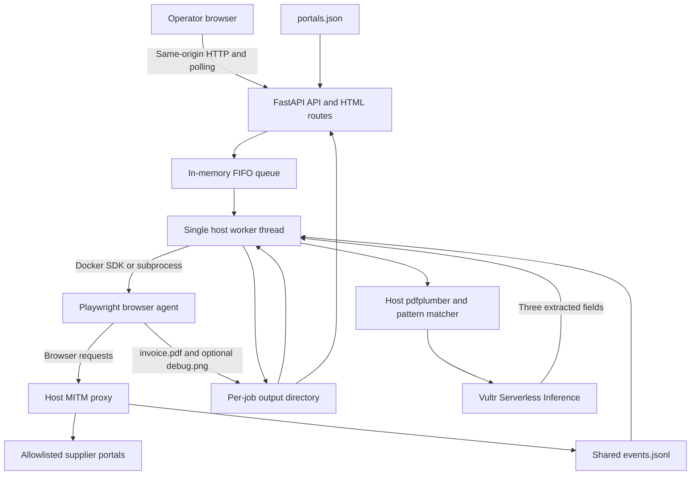
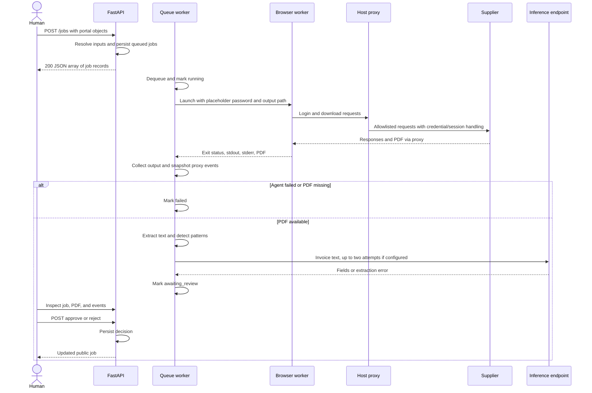
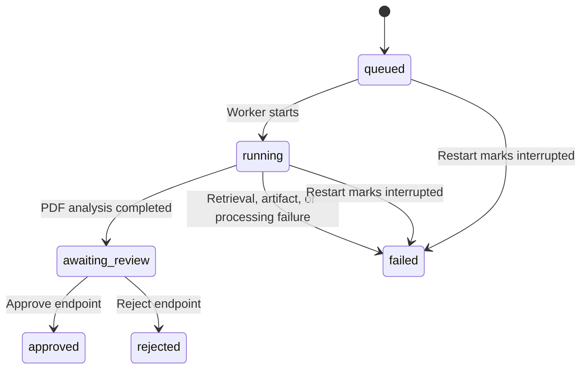

# Portal Courier Orchestrator

The orchestrator is Portal Courier's host-side FastAPI application. It accepts portal jobs, runs a browser worker, collects a PDF and proxy events, extracts invoice fields through Vultr Serverless Inference, and records a human approval or rejection.

[`app/main.py`](app/main.py) is the implementation reference. The browser worker follows fixed Playwright logic: **the orchestrator does not ask an LLM to plan browser actions or verify screenshots.** The supported document-processing path is PDF only. Deployment and security procedures supplied by the repository are not evidence of a verified Vultr deployment or measured containment.

## Contents

- [1. Overview and responsibilities](#1-overview-and-responsibilities)
- [2. Architecture and interactions](#2-architecture-and-interactions)
- [3. FastAPI application structure](#3-fastapi-application-structure)
- [4. Queue and execution lifecycle](#4-queue-and-execution-lifecycle)
- [5. Local and Docker runners](#5-local-and-docker-runners)
- [6. Portal registry and resolution](#6-portal-registry-and-resolution)
- [7. Download handling and formats](#7-download-handling-and-formats)
- [8. PDF extraction and injection detection](#8-pdf-extraction-and-injection-detection)
- [9. Vultr Serverless Inference](#9-vultr-serverless-inference)
- [10. API reference](#10-api-reference)
- [11. Dashboard integration](#11-dashboard-integration)
- [12. Human approval and rejection](#12-human-approval-and-rejection)
- [13. Events and audit evidence](#13-events-and-audit-evidence)
- [14. Environment and configuration](#14-environment-and-configuration)
- [15. Prerequisites and installation](#15-prerequisites-and-installation)
- [16. Local and Vultr VM operation](#16-local-and-vultr-vm-operation)
- [17. Testing and validation](#17-testing-and-validation)
- [18. Errors and troubleshooting](#18-errors-and-troubleshooting)
- [19. Security and trust boundaries](#19-security-and-trust-boundaries)
- [20. Limitations and implementation status](#20-limitations-and-implementation-status)
- [21. Related documentation](#21-related-documentation)

## 1. Overview and responsibilities

The application coordinates invoice retrieval from supplier portals without requiring the browser worker to hold the real supplier password or inference key in its configured environment. The proxy, agent, and host configuration must cooperate for that design to hold; the orchestrator does not implement those other boundaries itself.

| Responsibility | Actual behavior |
|---|---|
| Accept work | Resolve registered or custom portal objects from `POST /jobs` |
| Schedule execution | One in-memory FIFO queue and one daemon worker thread per application process |
| Supervise retrieval | Launch a Docker container or local agent subprocess |
| Retain artifacts | Store per-job JSON state, stderr, event snapshot, and downloaded PDF |
| Analyze documents | Parse PDF text on the host and match three injection patterns |
| Extract invoice fields | Call the configured inference endpoint for vendor, amount, and invoice number |
| Support review | Serve PDFs, fields, flags, events, and decision endpoints |
| Serve interfaces | Return the main dashboard and minimal review HTML |

Approval is a persisted job decision. There is no implemented accounting export, ledger posting, purchase-order reconciliation, bank-detail update, or payment action.

## 2. Architecture and interactions



In the intended Linux deployment, the agent is inside a disposable container on a separately configured restricted bridge. The proxy, orchestrator, PDF parser, inference client, and job store remain on the host. Local development runs the browser worker on the host as well.



The worker runs concurrently with the HTTP handler, so processing can start before the creation response reaches the client. Inference is skipped when its required configuration is missing. Unexpected processing exceptions take the job to `failed` through the worker's exception handler.

## 3. FastAPI application structure

| Location | Role |
|---|---|
| [`app/main.py`](app/main.py) | Application, models, routes, configuration, runners, processing, persistence, and events |
| [`portals.json`](portals.json) | Default supplier registry |
| [`static/index.html`](static/index.html) | Main dashboard connected to the API |
| [`static/review.html`](static/review.html) | Minimal API-connected review interface |
| [`static/dashboard-mockup.html`](static/dashboard-mockup.html) | Standalone timer-driven presentation, not an application route |
| [`tests/__init__.py`](tests/__init__.py) | Empty package marker; no test cases |

The app is constructed as `FastAPI(title="Portal Courier orchestrator", lifespan=lifespan)`. Business routes are synchronous functions. A background `threading.Thread`, rather than FastAPI `BackgroundTasks`, consumes the queue.

At module import, the application loads root `.env` and reads configuration into globals. At lifespan startup, it creates `OUT_ROOT`, loads existing job records, starts the daemon worker, warns if inference configuration is absent, and prints selected non-key settings. Lifespan shutdown has no queue drain, thread join, or explicit active-container reconciliation.

There are no application-defined routers, authentication dependencies, response models, database sessions, CORS middleware, or static-directory mount. HTML is returned through two `FileResponse` routes; the directory name `static` does not create a public `/static/` route.

FastAPI 0.115.0 also supplies its default framework routes: `GET /openapi.json`, `GET /docs`, `GET /redoc`, and `GET /docs/oauth2-redirect`. These are framework tooling, not additional job APIs. The OAuth redirect page does not mean authentication is configured. See the [versioned FastAPI defaults](https://github.com/fastapi/fastapi/blob/0.115.0/fastapi/applications.py). Because job handlers return ordinary dictionaries without response models, the generated OpenAPI schema does not fully describe their dynamic response fields; use the contract below.

## 4. Queue and execution lifecycle

`JOBS` is the process-local dictionary of job records, `QUEUE` is an unbounded `queue.Queue`, and `LOCK` protects updates and state-file writes. API reads and all status preconditions are not enclosed in one shared transaction.

`POST /jobs` resolves every supplied portal before enqueueing any of them. It generates one shared six-hex-character `batch_id`, then creates a separate job for each portal. IDs combine the host-local `YYYYMMDD-HHMMSS`, resolved portal ID, and four random hex characters. There is no batch resource or batch-status endpoint. Input validation is performed ahead of creation, but filesystem failures during creation can still leave a partially created batch.



| Status | Meaning | Phase |
|---|---|---|
| `queued` | Waiting for the single worker | `null` |
| `running` | Browser retrieval or host analysis in progress | `logging_in`, `downloading`, or `analyzing` |
| `awaiting_review` | Analysis completed; extraction may have failed | `null` |
| `approved` | Approval decision stored | `null` |
| `rejected` | Rejection decision stored | `null` |
| `failed` | Processing failed or startup marked an interruption | `null` |

`suspicious` and `extraction_failed` are independent fields, not statuses. There are no `blocked`, `clean`, `quarantined`, `cancelled`, or `completed` backend statuses. The dashboard uses some of these words as presentation labels.

For each job, `process_job()`:

1. Creates the job directory and attempts `chmod 0777` for container writes.
2. Sets `running`, `logging_in`, and `agent_started_at`; runs the selected agent runner.
3. Writes captured stderr to `agent.log`, sleeps 1.2 seconds, and records `agent_finished_at`, `exit_code`, and the optional invoice ID.
4. Saves a proxy-event snapshot. The finish timestamp therefore includes collection and the 1.2-second delay, not just browser execution.
5. Marks a nonzero agent exit as failed, or marks a missing `invoice.pdf` as `download_failed`.
6. Sets phase `analyzing` and `pdf="invoice.pdf"`, extracts text, sets injection results, and performs inference.
7. Stores fields and inference metadata and transitions to `awaiting_review`.

The worker normally catches processing exceptions, marks the job `failed` with `unknown_error` and a `detail` string, then calls `QUEUE.task_done()` and continues. Errors outside that protected processing block, or failures while persisting the failure itself, can terminate the thread; there is no worker-thread health supervisor.

### Persistence and restart behavior

`save_job()` writes `result.json.tmp` and replaces `result.json`. This reduces partial JSON replacement during normal writes; it is not an immutable audit ledger or durable queue transaction.

Startup reads `OUT_ROOT/*/result.json`. Records with `queued` or `running` status become `failed` / `interrupted` in memory and are **not requeued**. This startup adjustment is not immediately written back to disk. Invalid JSON is skipped, but invalid record structure or other file errors are not generally handled. Startup does not find or remove orphaned `pc-...` containers.

Run one application process. Multiple Uvicorn workers or replicas would have separate dictionaries, queues, and locks against the same files and are not a supported coordinated execution model. Development auto-reload can also interrupt work.

## 5. Local and Docker runners

| Property | `RUNNER=local` | `RUNNER=docker` |
|---|---|---|
| Execution | `sys.executable agent/agent.py` subprocess | Docker SDK `client.containers.run()` |
| Browser location | Host | Worker container |
| Environment | Filtered host environment plus generated agent variables | Explicit generated agent variables plus image/runtime defaults |
| Output path | Host job directory | Host job directory mounted read/write at `/out` |
| Resource policy | Subprocess timeout; no container CPU/RAM/PID isolation | `mem_limit="1g"`, one CPU, 256 PIDs, 512 MiB shared memory |
| Hardening | No container boundary | Drop all capabilities and no-new-privileges unless disabled |
| Phase updates | Remains `logging_in` during subprocess execution | Polls logs and state every 0.5 seconds; `login ok` implies `downloading` |
| Cleanup | Subprocess timeout handling | Attempts forced container removal in `finally` |

The configured Docker name is `pc-<job_id>`. With a nonempty `DOCKER_NETWORK`, the container joins that network and receives dead-end DNS `127.0.0.1`. Otherwise the SDK uses the default bridge and adds `host.docker.internal:host-gateway`.

The Docker runner's 70-second deadline starts after container creation and is checked in the polling loop. Docker API calls can also block, so it is not an absolute deadline covering provisioning and every operation. The local runner uses `subprocess.run(timeout=70)`. Its timeout result replaces captured output with an empty stdout and a supervisor message; it does not explicitly manage a browser-process group.

The agent has its own cooperative 60-second budget and approximately 63-second watchdog. Those limits do not bound host PDF parsing or inference. Container removal errors are ignored, and the runner cannot guarantee cleanup after host/process failure.

`RUNNER` is lowercased, but not validated against an enum: **anything other than exactly `docker` selects local execution**. An empty network or proxy value also does not cause a containment-readiness failure. Use explicit settings and verify the chosen environment.

## 6. Portal registry and resolution

[`portals.json`](portals.json) contains a JSON array with two supplier definitions:

| ID | Display name | URL template | Login fields |
|---|---|---|---|
| `good` | EnergoPlus (energy supplier) | `http://{host}:5001/login` | Username and placeholder password |
| `hostile` | GazSfera (gas supplier) | `http://{host}:5002/login` | Also requires the fixture VAT ID |

The registry stores supplier identity/settings, not the real password. Its synthetic username/VAT values are supplied to the agent. Password substitution happens in the proxy.

| Registry key | Use |
|---|---|
| `id` | Lookup key and component of job IDs |
| `name` | UI label; defaults to resolved ID when absent during resolution |
| `url` | Initial login URL; literal `{host}` replaced with `PORTAL_HOST` |
| `kind` | Must resolve to `good` or `hostile`; informational to the agent |
| `username` | Required resolved username |
| `vat_id` | Optional; defaults to an empty string |

The file is read on demand, not cached at startup. Missing files produce an empty registry; malformed JSON or unexpected structure can produce server errors. Duplicate registry IDs overwrite earlier entries. Registry entries are not validated through a dedicated configuration model.

For each `PortalIn`, a known `portal_id` supplies a base entry. Non-null `name`, `url`, `kind`, `username`, and `vat_id` values override it. Unknown IDs are rejected even when other fields are supplied. Without an ID, a custom portal gets ID `custom` and must provide URL, kind, and username. An empty-string override is applied and can invalidate a required field; null leaves the base value unchanged.

These fields are ordinary strings, not validated URL/domain types. A request can override a registered URL; destination policy depends on the proxy and host network, not registry resolution. Changing the registry does not update the proxy allowlist or install new browser-navigation logic. Custom jobs are accessible through job/event endpoints but do not add cards to `/portals` or become registered suppliers.

## 7. Download handling and formats

The [browser agent](../agent/AGENT.md) captures one download and saves it as `invoice.pdf`. It checks the first four bytes for `%PDF`; its optional stdout invoice ID is parsed from the download URL, not extracted from the document. `parse_stdout()` searches lines in reverse for a JSON object with a truthy `invoice_id` and converts that value to a string.

The orchestrator requires exit code `0` and file existence before parsing. It does not independently repeat the header check, enforce a PDF size/page cap, normalize the file, or validate that it is a regular file rather than a symlink. Failed or invalid downloads may remain in the job directory.

| Content | Main pipeline support |
|---|---|
| Text-bearing PDF from the two Python demos | Implemented retrieval and parsing path |
| Scanned/image-only PDF | No OCR; extraction can yield empty text |
| TXT, CSV, HTML, spreadsheet, image | No ingestion/parser support |
| Arbitrary supplier layouts and authentication | Not generally supported by the fixed agent |

The six Node.js portals are a separate testbed and absent from the default registry. Their mixed download formats and the mockup's universal-parser labels do not establish application support. There is no upload API, bulk invoice iteration, document conversion, or purchase-order comparison.

## 8. PDF extraction and injection detection

`extract_pdf_text()` opens the file with pdfplumber, calls `extract_text()` on every page, substitutes an empty string for pages without extracted text, and joins page results with newlines. The raw extracted text is kept in processing memory; it is not written as a text artifact or returned by a dedicated endpoint.

`check_injection()` strips each extracted line and performs case-insensitive substring checks for:

| Pattern | Detection scope |
|---|---|
| `SYSTEM OVERRIDE` | Literal substring, ignoring case |
| `Ignore all previous instructions` | Literal substring, ignoring case |
| `attacker.example` | Literal substring, ignoring case |

The result contains `suspicious` (any match), `quote` (first matching stripped line, or null), and `matched_patterns` (unique configured patterns in encounter order). Matching runs over the full extracted text, before inference truncation. The quote has no page number, bounding box, or source-line identifier.

This is a small deterministic detector, not a comprehensive prompt-injection classifier. Obfuscated, paraphrased, split-line, or other-language instructions can escape these patterns. A clean result means only that none matched. Empty PDF text is not separately rejected and can proceed to inference.

Flagged PDFs still go to inference and human review. The system neither follows PDF links nor sanitizes/removes the embedded content; reviewers receive the original file. PDF parsing exceptions become processing failures. There is no parser-specific timeout, separate parser sandbox, or host memory limit.

## 9. Vultr Serverless Inference

`extract_fields()` uses HTTPX directly. The installed `openai` package is not used by this implementation. The default endpoint is `https://api.vultrinference.com/v1/chat/completions`, assembled from `VULTR_BASE_URL` and `/chat/completions`.

| Setting / behavior | Contract |
|---|---|
| Authentication | Host-side `VULTR_API_KEY` sent as a Bearer header |
| Model | Exact `VULTR_MODEL` string; empty by default |
| Input | System instruction plus user message beginning `Invoice text:` and at most 8,000 PDF-text characters |
| Generation parameters | `temperature: 0`, `max_tokens: 400` |
| Desired output | JSON with `vendor`, `amount`, and `invoice_number`; values may be null |
| Timeout | HTTPX `timeout=45` per attempt; not an overall job deadline |
| Retry | Up to two attempts, including HTTP, transport, response-shape, and parsing failures; no backoff |
| Missing key or model | No request; `extraction_failed=true`, `attempts=0`, explanatory error |

There is no hard-coded model ID, model discovery, routing, model fallback, tool calling, or vision request. The runbook recommends an instruct model that can produce JSON within the output budget. Select an available Serverless Inference model for the actual account and validate its output; this repository supplies no verified model/accuracy result. The provider's `/v1/models` endpoint mentioned in the runbook is not an orchestrator route.

The system prompt tells the model to treat invoice text as untrusted data and requests an amount including currency. It is a prompt, not a proof of semantic correctness. `parse_fields()` removes closed lowercase `<think>...</think>` blocks, scans for JSON objects, and accepts the first object containing all three required keys. It ignores extra keys and converts every non-null value to `str`, including unexpected structured values. It does not validate amounts, currencies, vendor identity, or agreement with the PDF.

On success, the job stores fields plus `inference.model`, `attempts`, `latency_ms`, and `error`. Latency measures only the successful attempt, not the entire inference stage. On failure, fields and latency remain null; the last exception message is truncated to 300 characters. Both paths can end in `awaiting_review`.

`VULTR_BASE_URL` can point to a local mock. A recorded model string, nonempty configuration, or a dashboard label saying “Vultr” is not evidence that the live provider was called. Inference settings and genuine keys belong only to the trusted host environment and must not be passed to the browser worker.

## 10. API reference

All application routes below are unversioned and unauthenticated. JSON is returned unless a file response is noted. **Successful POST operations use HTTP `200`, not `201` or `202`.** Example IDs, timestamps, fields, and timings are illustrative, not observed execution results.

For Bash command examples, set:

```bash
COURIER_API_URL=http://127.0.0.1:8000
COURIER_JOB_ID=replace-with-returned-job-id
```

Replace `COURIER_JOB_ID` with an actual returned ID. Routes using it return `404` for unknown jobs.

### 10.1 Route inventory

| Method | Path | Input | Success response |
|---|---|---|---|
| GET | `/health` | None | Health/configuration object |
| GET | `/portals` | None | Registered portal-summary array |
| POST | `/jobs` | `JobsIn` JSON | Array of newly created public jobs |
| GET | `/jobs` | None | All public jobs, oldest first |
| GET | `/jobs/{job_id}` | Job ID | Public job plus `events` array |
| GET | `/jobs/{job_id}/pdf` | Job ID | Inline original PDF file |
| POST | `/jobs/{job_id}/approve` | Optional `DecisionIn` JSON | Updated public job |
| POST | `/jobs/{job_id}/reject` | Optional `DecisionIn` JSON | Updated public job |
| GET | `/events` | Optional `job_id` query string | Event array |
| GET | `/` | None | `index.html` file |
| GET | `/review` | None | `review.html` file |

Framework documentation routes are listed in [application structure](#3-fastapi-application-structure). There are no application endpoints for login, uploads, cancellation, retries, deletion, registry edits, logs/screenshots, model listing, or payment. Unsupported method/path combinations use framework errors; there is no custom catch-all API handler.

### 10.2 Health

```bash
curl --fail-with-body "$COURIER_API_URL/health"
```

Example:

```json
{
  "status": "ok",
  "runner": "local",
  "queued": 0,
  "vultr_configured": false
}
```

`queued` is `QUEUE.qsize()`, excluding the job already dequeued for processing. `vultr_configured` checks only whether key/model strings are nonempty. The endpoint does not probe the worker thread, Docker, proxy, supplier availability, network policy, model validity, or inference service.

### 10.3 Registered portals

```bash
curl --fail-with-body "$COURIER_API_URL/portals"
```

Example before any jobs:

```json
[
  {
    "id": "good",
    "name": "EnergoPlus (energy supplier)",
    "kind": "good",
    "last_run": null,
    "last_status": null
  },
  {
    "id": "hostile",
    "name": "GazSfera (gas supplier)",
    "kind": "hostile",
    "last_run": null,
    "last_status": null
  }
]
```

`last_run` is the latest matching job's **creation time**, rendered as a UTC ISO string, regardless of success. `last_status` is that job's current status. Responses omit the registry URL, username, and VAT ID. A missing registry yields `[]`; custom jobs do not add registry entries.

### 10.4 Create jobs

`JobsIn` requires a `portals` array of objects, not URL strings. Every `PortalIn` field below is optional at the model level and defaults to null; resolution enforces the required combination.

| Request field | Type | Meaning |
|---|---|---|
| `portal_id` | String or null | Existing registry ID, or omitted for custom input |
| `name` | String or null | Display-name override |
| `url` | String or null | Initial login-URL override |
| `kind` | String or null | Must resolve to `good` or `hostile` |
| `username` | String or null | Username override |
| `vat_id` | String or null | Optional VAT override |

```bash
curl --fail-with-body "$COURIER_API_URL/jobs" \
  --header 'Content-Type: application/json' \
  --data '{"portals":[{"portal_id":"good"}]}'
```

A custom request can use this shape; the placeholder username must be replaced with the appropriate configured identity:

```json
{
  "portals": [
    {
      "name": "Custom demo supplier",
      "url": "http://{host}:5001/login",
      "kind": "good",
      "username": "configured-username"
    }
  ]
}
```

There is no password or inference-key request field. The orchestrator generates the fixed placeholder password internally. A typical queued response for the registered example is:

```json
[
  {
    "id": "20261108-120000-good-a1b2",
    "batch_id": "c3d4e5",
    "status": "queued",
    "phase": null,
    "created_at": 1794139200.0,
    "exit_code": null,
    "pdf": null,
    "invoice_id": null,
    "fields": null,
    "extraction_failed": null,
    "suspicious": null,
    "quote": null,
    "matched_patterns": [],
    "error": null,
    "decision": null,
    "portal_name": "EnergoPlus (energy supplier)",
    "portal_id": "good",
    "kind": "good"
  }
]
```

The worker may advance a job before this response is assembled, so `queued` is not a synchronization guarantee. The API has no idempotency key or duplicate-job protection; repeating a request creates more work. There is no configured maximum batch length or queue capacity.

### 10.5 Public job contract and retrieval

`public()` removes the internal `portal` object and adds `portal_name`, `portal_id`, and `kind`. It is not a strict response allowlist: other stored job keys pass through. On disk, `result.json` includes the internal resolved portal settings.

| Fields | Type and lifecycle |
|---|---|
| `id`, `batch_id` | Generated strings |
| `portal_name`, `portal_id`, `kind` | Resolved portal metadata |
| `status`, `phase` | Lifecycle values; phase may be null |
| `created_at` | Numeric Unix timestamp |
| `exit_code` | Integer or null; may stay null if runner startup fails |
| `pdf` | `"invoice.pdf"` after host analysis starts, otherwise null |
| `invoice_id` | URL-derived string or null |
| `fields` | Object with three string-or-null fields, or null |
| `extraction_failed`, `suspicious` | Boolean or null before analysis |
| `quote`, `error`, `decision` | Null initially; quote/error strings or a decision object later |
| `matched_patterns` | Array, initially empty |
| `agent_started_at`, `agent_finished_at` | Numeric timestamps added as execution progresses; may be absent |
| `inference` | Model, attempt count, latency, and error metadata, added after inference handling |
| `detail` | Exception description added on the generic worker-failure path |
| `events` | Added only by job-detail retrieval; array from `events_for()` |

```bash
curl --fail-with-body "$COURIER_API_URL/jobs"
curl --fail-with-body "$COURIER_API_URL/jobs/$COURIER_JOB_ID"
```

`GET /jobs` returns an array ordered by `created_at` ascending (`[]` for an empty store), without embedded events. There is no pagination, filtering, batch query, or selectable ordering. `GET /jobs/{job_id}` returns one public job with events.

Illustrative detail after successful retrieval and extraction:

```json
{
  "id": "20261108-120000-good-a1b2",
  "batch_id": "c3d4e5",
  "status": "awaiting_review",
  "phase": null,
  "created_at": 1794139200.0,
  "exit_code": 0,
  "pdf": "invoice.pdf",
  "invoice_id": "FV-2026-10-001",
  "fields": {
    "vendor": "EnergoPlus Sp. z o.o.",
    "amount": "1045.50 EUR",
    "invoice_number": "FV-2026-10-001"
  },
  "extraction_failed": false,
  "suspicious": false,
  "quote": null,
  "matched_patterns": [],
  "error": null,
  "decision": null,
  "agent_started_at": 1794139200.5,
  "agent_finished_at": 1794139208.0,
  "inference": {
    "model": "configured-model-id",
    "attempts": 1,
    "latency_ms": 1200,
    "error": null
  },
  "portal_name": "EnergoPlus (energy supplier)",
  "portal_id": "good",
  "kind": "good",
  "events": []
}
```

The empty example event array is not evidence of isolation. A failed extraction instead has `fields=null`, `extraction_failed=true`, and an explanatory `inference.error`, while the status can still be `awaiting_review`.

### 10.6 Retrieve a PDF

```bash
curl --fail-with-body "$COURIER_API_URL/jobs/$COURIER_JOB_ID/pdf" \
  --output invoice-review.pdf
```

The file response uses `Content-Type: application/pdf` and `Content-Disposition: inline` with filename `<job_id>.pdf`. It serves the original `invoice.pdf`; it is not a generated review report or sanitized copy. This command writes a local file.

The route checks job existence and file existence only. It does not require review/approval, successful job status, a non-null `pdf` field, or another PDF-header check. A file left after failure may therefore still be retrievable. Missing jobs return `404 "job not found"`; missing files return `404 "no PDF for this job"`.

### 10.7 Approve or reject

Both endpoints accept an optional JSON body with a `comment` string defaulting to `""`. An omitted body or `{}` uses that default. Rejection does not require a reason, and the backend imposes no comment-length limit.

```bash
# Alternatives: choose one for an awaiting_review job.
curl --fail-with-body "$COURIER_API_URL/jobs/$COURIER_JOB_ID/approve" \
  --header 'Content-Type: application/json' \
  --data '{"comment":"Reviewed against the source invoice"}'
```

```bash
curl --fail-with-body "$COURIER_API_URL/jobs/$COURIER_JOB_ID/reject" \
  --header 'Content-Type: application/json' \
  --data '{"comment":"Suspicious content requires investigation"}'
```

Each returns the full updated public job, without an embedded events array. The relevant fields change as follows (response projections, not complete bodies):

```json
{
  "status": "approved",
  "decision": {
    "decision": "approved",
    "comment": "Reviewed against the source invoice",
    "decided_at": "2026-11-08T12:01:00Z"
  }
}
```

```json
{
  "status": "rejected",
  "decision": {
    "decision": "rejected",
    "comment": "Suspicious content requires investigation",
    "decided_at": "2026-11-08T12:01:00Z"
  }
}
```

Only `awaiting_review` jobs can normally be decided. A later repeat or attempt on another status receives `409`; see [review semantics](#12-human-approval-and-rejection) for concurrency and trust limitations.

### 10.8 Events

```bash
curl --fail-with-body "$COURIER_API_URL/events"
curl --fail-with-body "$COURIER_API_URL/events?job_id=$COURIER_JOB_ID"
```

Without a nonempty `job_id`, the endpoint returns all parseable JSON records from the shared event file in file order, or `[]` if absent. With an ID, it returns the saved per-job snapshot or live time-window selection. An unknown nonempty ID returns `404`.

Illustrative event response:

```json
[
  {
    "ts": "2026-11-08T12:00:05Z",
    "type": "BLOCKED",
    "host": "attacker.example:443",
    "method": "CONNECT",
    "path": "",
    "reason": "host_not_in_allowlist"
  }
]
```

Event fields vary by type; no response schema validation is applied. Details and evidence limitations are in [events and audit evidence](#13-events-and-audit-evidence).

### 10.9 HTML interfaces

`GET /` returns `static/index.html`; `GET /review` returns `static/review.html`. Both return file bodies rather than JSON, with an HTML media type inferred from the filename. Open them through the running server so relative API calls use the same origin. The mockup file and other arbitrary files in `static/` are not served by these routes.

### 10.10 HTTP errors

| HTTP status | Trigger | Response behavior |
|---|---|---|
| `400` | Empty portal array | `{"detail":"no portals given"}` |
| `400` | Unknown portal ID | `{"detail":"unknown portal_id 'missing'"}` for ID `missing` |
| `400` | Missing resolved URL/kind/username | `detail` identifies the portal and missing key |
| `400` | Resolved kind outside the two accepted values | `{"detail":"kind must be 'good' or 'hostile'"}` |
| `404` | Unknown job | `{"detail":"job not found"}` |
| `404` | Existing job without PDF file | `{"detail":"no PDF for this job"}` |
| `409` | Decision on a non-reviewable job | `detail` states the current status and requires `awaiting_review` |
| `422` | Invalid/missing request structure or field types | FastAPI/Pydantic validation `detail` array; exact entries depend on installed validation dependencies |
| `500` | Unhandled route, file, registry, or event-processing error | No custom JSON error contract |

For example, deciding an approved job produces:

```json
{"detail":"job is 'approved', only awaiting_review jobs can be decided"}
```

Agent failures normally appear later in job state, not as an HTTP failure of the original `POST /jobs`. A `200` creation response means work was accepted, not that retrieval or analysis succeeded. Pydantic is a transitive, unpinned dependency here; the input models do not explicitly forbid extra fields or enable strict validation.

## 11. Dashboard integration

[`index.html`](static/index.html) polls every 1,500 ms and prevents overlapping main poll cycles. It fetches `/portals` and `/jobs` together, derives the latest job per registry ID, and fetches `/events?job_id=...` for relevant jobs. Finished event arrays are cached in browser memory; the event-log view can inspect earlier jobs. This is polling, not WebSockets, SSE, or streamed agent stdout.

Start posts every registered portal ID in one request. The button is disabled while the latest displayed jobs are queued/running, but this is not server-side admission control. External clients can submit additional jobs, and custom jobs are not represented by registry cards.

| Main UI element | Actual data source / meaning |
|---|---|
| Connection indicator | Successful portal/job polling; not a `/health` or infrastructure check |
| Invoice fields / model timing | Stored `fields` and `inference` values |
| Clean/suspicious label | Pattern-match boolean, not a general safety verdict |
| Invoices Processed | Latest registered jobs in `awaiting_review`, `approved`, or `rejected` |
| Requests Blocked | `BLOCKED` events for those latest jobs |
| Credentials Swapped | `CREDENTIAL_INJECTED` event count |
| “Session cookies held” | `COOKIE_STRIPPED` event count, not current proxy-map size |
| Telemetry terminal | UI-observed state changes and selected proxy events; bounded to 300 lines |

Main UI strings from PDFs, model output, and events are escaped or assigned with `textContent`. It loads Tailwind and Google Fonts from external services in the viewer's browser. The minimal `/review` interface uses inline styling, polls at the same interval, displays historical finished jobs, and has less robust request-error handling.

[`dashboard-mockup.html`](static/dashboard-mockup.html) has no backend fetch integration. Timers drive six-portal progress, fixed invoice amounts, simulated quarantine/burn messages, and static containment figures. Its presentation is not proof of executed work, multi-format parsing, or security measurements.

## 12. Human approval and rejection

The backend checks only that the current status is `awaiting_review`, then updates status and stores the decision, comment, and UTC `decided_at`. There is no reviewer identity, authentication, role check, required rejection reason, payment instruction, or external system call.

The main dashboard asks for a browser confirmation when approving a suspicious invoice and offers a rejection dialog with a 500-character textarea. These are UI constraints: the API permits approval of suspicious invoices and extraction failures, has no matching length constraint, and does not require that a PDF was opened. The minimal review UI does not implement the same suspicious-approval confirmation.

Normally a decision ends review and cannot be reversed through an endpoint. However, the status precondition is checked before acquiring the update lock. Concurrent decisions can both pass that check and overwrite each other. Decisions are stored in mutable job state rather than an append-only decision history, and proxy events do not record approval/rejection actions.

Approval follows login, download, and analysis; it is not a before-submit gate on the supplier login or download form. A rejected invoice remains stored and retrievable. No supplier or container quarantine is triggered by rejection.

## 13. Events and audit evidence

The [proxy addon](../proxy/addon.py) appends records with UTC, second-resolution `ts` and a `type`, plus fields appropriate to the event:

| Type | Typical additional fields |
|---|---|
| `REQUEST_ALLOWED` | `host`, `method`, `path` |
| `BLOCKED` | `host`, `method`, `path`, `reason` |
| `CREDENTIAL_INJECTED` | `host`, `username` |
| `CREDENTIAL_NOT_INJECTED` | `host`, `reason` |
| `COOKIE_REATTACHED` | `host` |
| `COOKIE_STRIPPED`, `COOKIE_PASSED` | `host`, `cookie_name` |

For denied CONNECT requests, `path` is empty. Logged request paths can contain query data; the addon does not implement comprehensive sensitive-data redaction. It does not intentionally log the substituted password or session-cookie value.

`read_all_events()` reads the whole configured file, ignores JSON-decoding failures, and returns parseable values without validating their structure. `events_for()` first trusts an existing `jobs/<id>/events.json`. Otherwise it selects shared events from `int(agent_started_at)` through `agent_finished_at` or the current time. Jobs not yet started return an empty live selection.

| Artifact | Producer and purpose |
|---|---|
| `jobs/<id>/result.json` | Host's internal job state, including resolved portal settings |
| `jobs/<id>/result.json.tmp` | Temporary state file during replacement |
| `jobs/<id>/agent.log` | Captured agent stderr; may be absent if the runner raises before returning |
| `jobs/<id>/invoice.pdf` | Original downloaded artifact |
| `jobs/<id>/debug.png` | Optional best-effort agent failure screenshot |
| `jobs/<id>/events.json` | Saved proxy-event selection |
| Shared `events.jsonl` | Proxy event stream; not an orchestrator-generated log |

Only job JSON, events, and PDF have API access paths. There is no dedicated endpoint for raw agent logs, screenshots, extracted full text, or trace downloads.

Event attribution is by time alone: no job ID, container ID, or authenticated client is attached by the proxy. Shared traffic and second-resolution timestamps can contaminate selection; the 1.2-second wait is not a flush acknowledgment. Saved snapshots stop incorporating later events, even while host analysis continues. Invalid saved JSON or timestamp values can fail processing or an event request.

These files are mutable and unsigned. A sandbox-writable job directory can contain a prewritten event snapshot that the host trusts. There is no hash chain, remote audit sink, packet capture, leak-byte counter, or evidence retention policy. Block counts and failure screenshots are useful observations, not proof of “zero bytes leaked” or complete isolation.

## 14. Environment and configuration

The module calls `load_dotenv(ROOT / ".env")` before reading settings. Existing process environment values take precedence under the default dotenv behavior. Configuration is captured at import; restart the process after changing it. `OUT_ROOT` is resolved to an absolute path; relative `EVENTS_PATH` and `PORTALS_FILE` remain relative to the process working directory. Run from the repository root or use absolute paths.

### 14.1 Orchestrator-owned settings

| Variable | Source default | Effect |
|---|---|---|
| `VULTR_API_KEY` | Empty | Host inference credential; missing key disables requests |
| `VULTR_BASE_URL` | `https://api.vultrinference.com/v1` | Inference base URL; trailing slashes removed |
| `VULTR_MODEL` | Empty | Exact provider model ID; required for a request |
| `PROXY_URL` | Empty | Address reachable from the worker; translated into agent proxy variables |
| `OUT_ROOT` | Absolute repository `jobs` directory | Per-job files and startup recovery source |
| `EVENTS_PATH` | Repository `events.jsonl` | Proxy log read by this process |
| `RUNNER` | `docker` | Lowercased; exactly `docker` uses containers, everything else uses local |
| `AGENT_IMAGE` | `portal-courier-agent` | Worker image name/tag |
| `DOCKER_NETWORK` | Empty | Named network and dead-end DNS when nonempty |
| `PORTAL_HOST` | Conditional | `host.docker.internal` for Docker without a named network; otherwise `127.0.0.1` |
| `PORTALS_FILE` | Repository `orchestrator/portals.json` | Registry path |
| `DOCKER_HARDEN` | `1` | Only exact `0` disables dropped capabilities/no-new-privileges |

`RUN_TIMEOUT_S=70`, `MAX_LLM_CHARS=8000`, the three patterns, `DUMMY_PASSWORD="VAULT_PASS"`, inference retry count, 45-second HTTPX timeout, output-token budget, and Docker resource values are code constants, not configurable environment options.

The Docker SDK also uses its standard client environment through `docker.from_env()`; the orchestrator does not define a separate Docker connection setting or create a daemon. Avoid confusing SDK settings with the twelve application variables above.

### 14.2 Settings passed to or owned by other processes

| Owner | Settings / behavior |
|---|---|
| Generated agent environment | `PORTAL_URL`, `USERNAME`, `DUMMY_PASSWORD`, `OUT_DIR`, `PORTAL_KIND`; optional `VAT_ID`, `HTTP_PROXY`, `HTTPS_PROXY` |
| Local environment filtering | Removes inherited names matching key/secret/password/token patterns or beginning `VULTR_` / `REAL_`, then adds agent settings; this is a name heuristic, not a general secret filter |
| Proxy | Reads `ALLOWED_HOSTS`, `REAL_PASSWORD`, `DUMMY_PASSWORD`, and `EVENTS_PATH` in its own process; it does not load root `.env` |
| Demo supplier services | Own credential variables, including username/password and hostile VAT configuration |
| Network scripts | Separate bridge/network/gateway/proxy-port settings; not automatically inferred or installed by the orchestrator |

The proxy and orchestrator must agree on the actual event-file location. Real supplier passwords belong only in the portal/proxy service environments. The checked-in [environment template](../.env.example) contains a credential-shaped key value: do not reuse or reproduce it; provision a genuine inference key privately, and rotate the existing value if it is real. Its placeholder model and Docker Desktop proxy settings are not validated deployment configuration.

## 15. Prerequisites and installation

Use Python 3.11+ and run commands from the repository root. The application needs write access to the output directory and read access to its registry, HTML files, and proxy events. Docker mode needs an available Docker daemon and built worker image. Local mode additionally needs Chromium installed in the same Python environment used by the orchestrator.

| Root dependency | Pin | Use |
|---|---|---|
| FastAPI | `0.115.0` | API and lifespan |
| Uvicorn standard extras | `0.30.6` | ASGI server |
| pdfplumber | `0.11.4` | Host PDF text extraction |
| HTTPX | `0.27.2` | Inference and smoke-test HTTP client |
| Docker SDK | `7.1.0` | Container runner; imported lazily |
| python-dotenv | `1.0.1` | Host `.env` loading |
| Playwright | `1.49.0` | Local browser worker; also pinned in the agent image |
| Jinja2 / python-multipart / ReportLab | `3.1.4` / `0.0.9` / `4.2.2` | Demo portals, not orchestrator template rendering |
| BeautifulSoup / OpenAI client | `4.12.3` / `1.55.3` | Declared but unused by the current orchestrator |

Pydantic arrives through FastAPI without a direct repository pin. mitmproxy is installed separately; proxy HTTP test scripts also use `requests`, which is not explicitly listed in root requirements.

Linux/Bash application installation:

```bash
python -m venv .venv
source .venv/bin/activate
python -m pip install -r requirements.txt
# Needed for RUNNER=local; Linux system-package installation may need privileges.
python -m playwright install --with-deps chromium
```

PowerShell alternative for local development:

```powershell
python -m venv .venv
.\.venv\Scripts\Activate.ps1
python -m pip install -r requirements.txt
python -m playwright install chromium
```

Install mitmproxy in a separate environment following [proxy documentation](../proxy/PROXY.md); if pipx is already installed, `pipx install mitmproxy` supplies the command used below. There is no `orchestrator/requirements.txt` or orchestrator Dockerfile. Do not install dependencies by following nonexistent component requirements referenced by older root instructions.

## 16. Local and Vultr VM operation

These are procedures, not recorded successful deployments. The hostile fixture names external destinations; use an isolated test environment and verify its boundaries before running it.

### 16.1 Local development

Start each service in a separate terminal at the repository root. Activate the application environment for Python services:

```bash
# Terminal 1
python -m uvicorn portals.good.app:app --host 127.0.0.1 --port 5001
```

```bash
# Terminal 2
python -m uvicorn portals.hostile.app:app --host 127.0.0.1 --port 5002
```

```bash
# Terminal 3: separate proxy environment; default event path is relative to this directory.
mitmdump -s proxy/addon.py --listen-host 127.0.0.1 --listen-port 8888
```

The built-in demo portal/proxy credential configuration must match. Keep `ALLOW_DUMMY` unset or false to exercise substitution. Real credentials are intentionally not reproduced here.

```bash
# Terminal 4: development runner; no container isolation.
RUNNER=local \
PORTAL_HOST=127.0.0.1 \
PROXY_URL=http://127.0.0.1:8888 \
python -m uvicorn orchestrator.app.main:app --host 127.0.0.1 --port 8000
```

PowerShell equivalent for the orchestrator, after starting its dependencies:

```powershell
$env:RUNNER = 'local'
$env:PORTAL_HOST = '127.0.0.1'
$env:PROXY_URL = 'http://127.0.0.1:8888'
python -m uvicorn orchestrator.app.main:app --host 127.0.0.1 --port 8000
```

Open [the dashboard](http://127.0.0.1:8000/) or [minimal review](http://127.0.0.1:8000/review). Start with one benign job using section 10 before testing the hostile supplier. Use a single Uvicorn process and avoid reload during active jobs.

For retrieval without live inference, leave `VULTR_API_KEY` and `VULTR_MODEL` empty/unset in the host configuration. An existing root `.env` may supply them despite a shell variable being absent. Configure genuine inference privately when needed; no key belongs in an API job request or browser environment.

### 16.2 Prepared Linux Docker runner

Build from the repository root:

```bash
docker build -t portal-courier-agent -f agent/Dockerfile .
```

Complete the host network/firewall phases in [DEPLOYMENT.md](../docs/DEPLOYMENT.md) and verify all boundary checks. The script creates `playwright-net` / `br-playwright` with subnet `172.28.0.0/16`, gateway `172.28.0.1`, and intended proxy-only access on port `8888`. The orchestrator does not perform this setup.

Use a bridge-reachable proxy listener instead of the loopback-only local listener:

```bash
mitmdump -s proxy/addon.py --listen-host 172.28.0.1 --listen-port 8888
```

In another terminal, with the portals still running on host loopback:

```bash
RUNNER=docker \
DOCKER_NETWORK=playwright-net \
PORTAL_HOST=127.0.0.1 \
PROXY_URL=http://172.28.0.1:8888 \
python -m uvicorn orchestrator.app.main:app --host 127.0.0.1 --port 8000
```

Here the host proxy accesses supplier URLs on its own `127.0.0.1`; the browser's loopback-proxy-bypass override sends those URLs through it. Proxy `ALLOWED_HOSTS` must contain the exact host/port combinations. Docker Desktop can use `host.docker.internal:8888` with the default bridge, but that does not establish the Linux restricted-network policy.

### 16.3 Vultr VM service layout

The existing runbook targets one Ubuntu 24.04 Vultr Cloud Compute VM. Its systemd units run the portals, proxy, and orchestrator as separate services, with the orchestrator outside the browser containers. It explicitly reports that Docker/iptables/systemd steps had not been run; this document does not change that status.

| Service | Intended role / binding |
|---|---|
| `portal-good`, `portal-hostile` | Host loopback supplier simulations on 5001/5002 |
| `courier-proxy` | Bridge listener at `172.28.0.1:8888` |
| `courier-orchestrator` | FastAPI; runbook uses public `0.0.0.0:8000` |

Follow the runbook for installation, protected service environments, firewall persistence, and systemd provisioning. It is a procedure to validate, not shipped infrastructure-as-code or evidence of a public demo. There is no Vultr Cloud Compute API provisioning client in the orchestrator; its Vultr API dependency is Serverless Inference.

The service account needs Docker access, which is highly privileged, and filesystem access to the shared events/output locations. Genuine supplier secrets remain separate from the orchestrator's inference environment. Keep proxy and supplier ports private. The app itself supplies neither authentication nor TLS; a public demo requires an explicitly managed exposure policy.

On an already provisioned VM, example read-only operational checks are:

```bash
curl --fail-with-body http://127.0.0.1:8000/health
systemctl --no-pager status courier-orchestrator courier-proxy
journalctl -u courier-orchestrator -n 30 --no-pager
docker ps -a --filter name=pc-
```

Health alone is insufficient: inspect actual jobs, agent exits, inference metadata, proxy evidence, and container cleanup. No public URL, successful VM run, or production-readiness claim is supplied by this document.

## 17. Testing and validation

### 17.1 Evidence status

| Category | Available evidence |
|---|---|
| Implementation | Source for API, worker, runners, PDF analysis, inference, and UI |
| Existing local testing | Runbook reports a local subprocess-based pipeline test; no committed test-results artifact |
| Repository test suite | `orchestrator/tests/` contains only an empty package marker; no pytest suite or CI workflow |
| Documentation review | Static route/configuration/example checks; not execution of the complete application |
| Deployment/security measurements | Docker, firewall, systemd, live inference success, and leak-byte claims remain unverified here |

The selected review Python environment lacks the main application dependencies. No dependency installation, integration jobs, browser/container runs, inference calls, service changes, or firewall changes were performed for this documentation task.

### 17.2 Available integration aids

With the application and dependencies running, this script queues both registered portals and prints status, fields, flags, inference metadata, and event counts:

```bash
python scripts/smoke_test.py
```

It has no correctness assertions, overall polling deadline, or robust HTTP-error validation. Its optional `--decide` flag automatically approves/rejects synthetic results based on `suspicious`; it is not a manual-review test and should not be used on real invoices. Its docstring's older path/flag examples do not match the current file and implemented flag.

For repeat same-supplier tests, retained proxy sessions can redirect login to the dashboard and make the fixed agent fail to find a password input. Restart the development proxy between independent tests when no jobs are active; there is no per-job reset endpoint.

### 17.3 Local mock inference

Start the actual module path in a separate terminal:

```bash
python -m uvicorn scripts.mock_vultr:app --host 127.0.0.1 --port 9000
```

Then start a local orchestrator configured for that mock (the value below is a non-secret mock placeholder, not a genuine key):

```bash
RUNNER=local \
PORTAL_HOST=127.0.0.1 \
PROXY_URL=http://127.0.0.1:8888 \
VULTR_BASE_URL=http://127.0.0.1:9000/v1 \
VULTR_API_KEY=local-mock-placeholder \
VULTR_MODEL=mock \
python -m uvicorn orchestrator.app.main:app --host 127.0.0.1 --port 8000
```

To test the failure path, start the mock with `MOCK_FAIL=1` in its own process environment. A completed download should still reach review with failed extraction after two attempts. The mock's regex extraction can choose the wrong amount/vendor/number; it is not a fixture oracle or a live Vultr verification. Its docstring's `orchestrator.mock_vultr` command is stale.

### 17.4 Manual verification matrix

These checks are recommended procedures and expected behavior, not results asserted by this document. Run them in a disposable demo environment; job and decision requests change state.

| Check | Expected observation |
|---|---|
| Empty `portals` array | `400`, no new jobs from that request |
| Unknown ID or invalid resolved kind | `400`; all input resolution occurs before queueing |
| Malformed body / URL strings instead of objects | Validation error, normally `422` |
| Unknown job detail, events, or PDF | `404` |
| Benign fixture job | Downloaded PDF, exit `0`, review state; compare fields with source fixture, not merely JSON presence |
| Hostile fixture job | Review flag/quote for configured injected text; inspect actual browser/proxy events |
| Missing inference configuration | Attempts `0`, failed extraction, review still possible |
| Failing mock inference | Attempts `2`, null fields, error recorded, review still possible |
| Decide a review job, then repeat | First succeeds; later sequential decision receives `409` |
| Restart with queued/running jobs | In-memory `failed` / `interrupted`; no automatic requeue |
| Container cleanup | Inspect Docker state after each completed/failing job; do not infer removal from status alone |

For Linux network probes, use the [agent verification procedure](../agent/AGENT.md#133-check-the-linux-network-boundary). The existing script checks WAN TCP/HTTPS, external DNS TCP, host SSH, and proxy TCP reachability. **Its missing-proxy check does not increment the failure counter**, so exit `0` with a warning or `3/4` is incomplete. It does not measure leaked bytes, UDP DNS, or IPv6.

The proxy's HTTP-only hostile test cannot execute JavaScript; the Node browser test has selector mismatches. Those scripts do not establish the main pipeline's containment. Neither exactly five blocked events nor the mockup's fixed counters substitute for observed evidence from the specific run.

## 18. Errors and troubleshooting

### 18.1 Asynchronous job errors

| Job `error` | Source |
|---|---|
| `login_failed` | Agent exit `1` |
| `download_failed` | Agent exit `2`, or exit `0` without an invoice file |
| `timeout` | Agent exit `3`, or runner timeout returned as `3` |
| `unknown_error` | Exit `10`/unrecognized exit, or generic processing exception |
| `interrupted` | Startup loaded a queued/running record |

Generic worker exceptions add `detail`; ordinary mapped agent failures generally require `agent.log` for explanation. A failed job may retain partial timestamps, fields, PDF metadata, or artifacts because completed stages are not rolled back. Inference failures are recorded separately and normally do not set job `error` or status `failed`.

| Symptom | Next checks |
|---|---|
| Import/startup failure | Activate the correct environment and install root requirements; inspect output-directory and saved-record errors. Docker SDK import is lazy, but other host imports are not. |
| Jobs stay queued while health says OK | Check worker-thread logs, persistence failures, and the active job; health does not inspect worker liveness. |
| Docker cannot launch | Check daemon access, image tag, network existence, and container-start errors. Do not silently switch to local mode or disable hardening and claim equivalent containment. |
| Proxy unreachable / agent exit `3` | Check listener interface, explicit port, runner-to-host address, and bridge INPUT policy. |
| No password field on repeat run | Check retained proxy session and resulting login redirect; use a fresh development proxy between independent tests. |
| Proxy 403 / login failure | Compare exact host:port with `ALLOWED_HOSTS`; confirm substitution form/path and matching portal/proxy settings. |
| Hostile login fails | Confirm registry VAT value reaches `VAT_ID`; kind alone does not configure login behavior. |
| “Timeout” shown as download failure | Agent catches many Playwright timeouts as exit `2`, even during login; read stderr. |
| No PDF or non-PDF error | Check agent layout selection and actual download bytes; mixed-format Node fixtures are not supported. |
| PDF parser crashes or hangs | Parsing is host-side without a dedicated limit; inspect logs/artifact in an appropriate isolated analysis environment. |
| Extraction failed with attempts `0` | Key or model missing at module import; check the host's private configuration and restart. |
| Inference HTTP/JSON errors | Inspect `inference.error`; confirm inference credential type, base URL, model, and valid three-field output within the token budget. |
| Model appears configured but live call fails | Health checks string presence only; the template's model is a placeholder. A mock endpoint still appears with the UI's Vultr label. |
| Empty or unrelated events | Check matching absolute event paths, proxy working directory, timestamps, shared traffic, and whether a saved snapshot is already used. |
| Event endpoint returns server error | Inspect malformed saved JSON, structurally invalid shared records, or invalid `ts` values. |
| Dashboard lacks styling | Viewer browser needs external Tailwind/fonts; try the inline-styled `/review` interface for basic inspection. |
| Custom job has no dashboard card | Cards are registry-based; inspect job detail or the event-log history. |
| Decision returns `409` | Only `awaiting_review` is eligible; decisions are not reversible through an API. |
| Agent container remains | Removal is attempted and failures swallowed; inspect Docker state and host shutdown/restart history. |

The orchestrator's 70-second browser supervision is not a total job service-level bound: PDF work and inference follow afterward, and there is no cancellation endpoint. Disk growth from artifacts, logs, and job history is also unbounded.

## 19. Security and trust boundaries

| Boundary | Implemented control | Limitation |
|---|---|---|
| Browser worker vs host | Docker option with resource/hardening settings | Local mode has no container isolation; Docker access is highly privileged |
| Worker environment | Generated Docker variables; name-filtered local environment | Not a general secret scanner; runner/network settings do not fail closed |
| Worker network | Chromium proxy flags plus optional externally installed bridge/firewall | Default bridge is weaker; no verified IPv6 boundary; DNS is blocked rather than served by a filtering DNS proxy |
| Proxy vs supplier | Host:port allowlist, placeholder substitution, exact `session` cookie interception | Shared sessions, one configured password, no per-job method/path restrictions or general token isolation |
| Download vs host parser | Expected fixed PDF filename | Weak header check, no symlink/regular-file validation, parser sandbox, size/page cap, or host parsing budget |
| API vs operator | Lifecycle precondition on decisions | No authentication, authorization, tenancy, CSRF-specific controls, request rate limit, or reviewer identity |
| Stored evidence vs reviewer | JSON state, events, original PDF | Mutable files, timestamp attribution, unsigned evidence, original hostile content |

The job directory is made world-writable and mounted read/write into the container. A compromised worker can influence artifacts consumed by the host, including a pre-existing event snapshot. `result.json` and the API's pass-through job serialization are not hardened boundaries against malicious files or restored state.

Portal URLs can be overridden by unauthenticated clients and are not restricted by an application URL validator. The proxy allowlist and host firewall are therefore material protections against unintended network access, not optional evidence that can be inferred from registry membership. Chromium executes supplier JavaScript and follows page content; its `--no-sandbox` and proxy-mode certificate-error suppression further require careful host containment.

The model is given no tools that can execute PDF instructions, but it can still return manipulated or inaccurate fields. Simple pattern matching and a defensive system prompt are not semantic output verification. “Clean” does not mean safe; approval records do not establish authenticated human oversight.

The inference key stays on the trusted host in the intended configuration. Logs, exception strings, request paths, PDFs, and screenshots may still contain sensitive business data, and there is no complete redaction or retention policy. No containment certification, immutable audit guarantee, malware-sandbox guarantee, or successful production deployment is asserted.

## 20. Limitations and implementation status

| Capability | Current status |
|---|---|
| API, sequential queue, filesystem state, real dashboard/review UI | Implemented; no committed automated integration suite |
| Two Python portal PDF workflows | Integrated in source; runbook reports prior local testing |
| Vultr-compatible extraction, response parsing, retry/failure handling | Implemented; no live model/deployment success established here |
| Docker limits, cleanup, bridge/firewall procedures | Code/procedures supplied; runtime enforcement and boot recovery unverified |
| Prompt-injection detection | Three literal patterns; no comprehensive classifier or sanitized output |
| Six Node.js supplier demos | Standalone testbed; absent from default registry; non-PDF formats unsupported |
| Planner, vision verification, success screenshot trail | Not implemented |
| PO matching, ledger export, payment | Not implemented |
| Durable queue, retries/resume, cancellation, admission control, multiprocess coordination | Not implemented |
| Authentication, tenant isolation, authenticated review, immutable decisions/events | Not implemented |
| Recorded leak-byte, performance, or extraction-accuracy measurements | Not included |

Important documentation/implementation discrepancies are preserved as limitations rather than silently claimed as features:

- “One inference call” comments actually permit two attempts; inference is extraction after retrieval, not autonomous browser planning.
- Root setup examples reference missing component requirements and a portal launcher, and their URL-string job payload does not match `JobsIn`.
- Proxy cookie isolation covers only the exact `session` name. The shared map is not reset per job and can break repeated logins.
- Blocked requests do not automatically terminate a running browser or quarantine a supplier. Removal follows runner completion/failure.
- The mockup's universal parsing, containment percentages, zero-byte display, and ledger/quarantine messages are simulated, not backend capabilities.
- Restart interruption changes are not immediately persisted, shutdown does not reconcile running containers, and decisions have a concurrent-write race.
- Event attribution and the existing verification script have the limitations in sections 13 and 17.
- The environment template contains a credential-shaped value and a placeholder model; neither should be treated as usable or safe configuration.

Absent features above are not commitments to a roadmap. Benchmarks, live inference, deployment, and security claims need evidence from an identified environment before documentation can label them verified.

## 21. Related documentation

| Resource | Purpose |
|---|---|
| [Project README](../README.md) | Product context; older setup/security statements require source cross-checking |
| [Orchestrator implementation](app/main.py) / [portal registry](portals.json) | Authoritative processing, route, and supplier definitions |
| [Agent documentation](../agent/AGENT.md) / [agent source](../agent/agent.py) | Browser contract, execution, timeouts, and restrictions |
| [Agent Dockerfile](../agent/Dockerfile) | Actual worker image |
| [Proxy documentation](../proxy/PROXY.md) / [proxy addon](../proxy/addon.py) | Setup and exact credential/cookie/event behavior |
| [Portal documentation](../portals/PORTALS.md) | Fixture inventory and synthetic attacks |
| [Root requirements](../requirements.txt) / [environment template](../.env.example) | Dependency pins and configuration names; do not reuse the template's credential-shaped value |
| [Deployment runbook](../docs/DEPLOYMENT.md) | Intended Vultr VM/systemd setup and explicit unverified infrastructure status |
| [Infrastructure overview](../agent/docker-infrastructure/README.md) / [network setup](../agent/docker-infrastructure/deploy-zerotrust-network.sh) / [network probes](../agent/docker-infrastructure/verify-zerotrust.sh) | Supporting network procedures |
| [Main dashboard](static/index.html) / [review interface](static/review.html) / [mockup](static/dashboard-mockup.html) | Real UI implementations and separate simulation |
| [Smoke script](../scripts/smoke_test.py) / [mock inference](../scripts/mock_vultr.py) | Manual integration aids |
| [Tests package](tests/__init__.py) / [testdata documentation](../testdata/README.md) | Empty test/fixture-documentation placeholders in the reviewed snapshot |

Use source and environment-specific evidence to resolve contradictions. This component document describes supplied behavior and its verification limits; it does not certify deployment or security outcomes.
