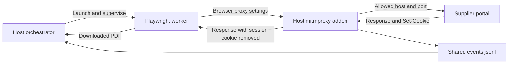

# Portal Courier: MITM Proxy

This proxy sits between the Playwright browser worker and the supplier portals. The addon implements host-and-port filtering, placeholder-password substitution, selected session-cookie handling, and event logging.

It is one part of the containment design, alongside the worker container and host firewall. **Its presence alone does not prove complete credential isolation, prevent every exfiltration channel, or establish zero bytes leaked.** The limitations below describe the actual implementation in [`addon.py`](addon.py).

## Contents

- [What it does](#what-it-does)
- [Architecture and trust boundaries](#architecture-and-trust-boundaries)
- [Prerequisites](#prerequisites)
- [Configuration](#configuration)
- [How to run](#how-to-run)
- [Request filtering](#request-filtering)
- [Credential injection](#credential-injection)
- [Session cookie handling](#session-cookie-handling)
- [Docker integration and network containment](#docker-integration-and-network-containment)
- [The event log](#the-event-log)
- [How to test the proxy](#how-to-test-the-proxy)
- [Security scope and verification status](#security-scope-and-verification-status)
- [Troubleshooting](#troubleshooting)
- [Related documentation](#related-documentation)

## What it does

1. **Host-and-port allowlist.** For requests handled by the addon, refuse destinations outside the configured set with `403 Forbidden` and a `BLOCKED` event.
2. **Credential injection.** Replace the non-secret placeholder `VAULT_PASS` in the supported login form with the proxy's configured supplier password.
3. **Session isolation for a named cookie.** Store cookies named exactly `session` in proxy memory, remove them from responses, and reattach the stored cookie to later requests. Other cookies pass through.
4. **Event logging.** Append structured records to `events.jsonl` and write a readable event message to mitmproxy's logger.

The addon does not start containers, install firewall rules, provide DNS service, parse invoices, call an LLM, or make approval decisions.

## Architecture and trust boundaries



In the intended Docker deployment, the worker is inside a disposable container while the proxy and orchestrator stay on the host. Host firewall rules supply an independent network restriction. Local subprocess execution and default-bridge development do not establish the same boundary.

The browser fills a placeholder, but the proxy and upstream supplier receive the real configured password. The password remains in a module-level variable for the proxy's lifetime and, when configured through an environment variable, in its process environment. There is no vault integration or secure-erasure mechanism. A compromised upstream can reflect sensitive data in a response, which the addon does not sanitize.

## Prerequisites

You need `mitmproxy` to run the addon. Install it in an isolated environment rather than the application's `.venv`; the deployment runbook also separates their dependencies.

The existing pipx installation procedure is:

```powershell
python -m pip install --user pipx
python -m pipx ensurepath
pipx install mitmproxy
```

Restart your terminal if needed so the `mitmdump` command becomes available. pipx manages an isolated environment; this is not an installation into the application's interpreter.

For the broader demo, install the [root Python requirements](../requirements.txt) and start the [supplier simulations](../portals/PORTALS.md#3-setup-and-run). Browser tests additionally need Playwright 1.49.0 and its Chromium installation, as documented in the [agent guide](../agent/AGENT.md#7-prerequisites-and-installation). The two HTTP test scripts require `requests`, which is not explicitly declared in root requirements.

mitmproxy is not version-pinned in this repository. Installation compatibility and runtime behavior need checking in the chosen proxy environment; this documentation update did not install or run it.

## Configuration

Defaults are set inside `addon.py` and can be overridden in the environment of the process that starts `mitmdump`. The addon does **not** load root `.env` or read settings from the orchestrator.

| Variable | Source default | Description |
|---|---|---|
| `ALLOWED_HOSTS` | `localhost:5001,localhost:5002,localhost:3000,127.0.0.1:5001,127.0.0.1:5002` | Comma-separated exact host:port entries; whitespace around entries is stripped and empty entries are discarded |
| `REAL_PASSWORD` | Built-in demo password, intentionally not reproduced | One password used for every qualifying substitution; keep genuine values only in trusted proxy/supplier service environments |
| `DUMMY_PASSWORD` | `VAULT_PASS` | Placeholder to match in a login form; the orchestrator currently sends this literal |
| `REAL_USERNAME` | Built-in demo username | Read into a module variable but unused by the addon; usernames are neither checked nor rewritten |
| `EVENTS_PATH` | `events.jsonl` | Event-file path; relative to the proxy process working directory |

`STRIPPED_COOKIES={"session"}` is a code constant, not an environment setting. The proxy listener address/port are mitmproxy command-line options, not addon variables. `PROXY_URL`, `DOCKER_NETWORK`, and `VULTR_API_KEY` are not proxy-addon settings.

Treat configuration as process startup configuration. Restart the proxy after changing its environment. Do not place real supplier passwords in the agent environment, job requests, logs, or shared orchestrator `.env`.

## How to run

Run from the **repository root**, using separate terminals. These are procedures and source-derived expectations, not records of successful runs.

### Start the demo suppliers

Use the application environment for Python services:

```powershell
# Terminal 1: benign Python portal
python -m uvicorn portals.good.app:app --host 127.0.0.1 --port 5001
```

```powershell
# Terminal 2: hostile Python portal
python -m uvicorn portals.hostile.app:app --host 127.0.0.1 --port 5002
```

The Node.js testbed is optional and separate from the default orchestrated workflow:

```powershell
# Optional terminal; install its dependencies first as described in PORTALS.md.
cd portals/node-portals
npm start
```

Keep `ALLOW_DUMMY` unset or false on Python portals when testing password substitution. Overridden supplier username/password settings must agree with the agent identity and proxy password; the addon does not rewrite the username.

### Start a local proxy

In another terminal, from the repository root:

```powershell
mitmdump -s proxy/addon.py --listen-host 127.0.0.1 --listen-port 8888
```

This binds the development listener to loopback. The addon default event path then resolves to the repository-root file expected by the orchestrator.

To select the event file explicitly in PowerShell before starting the same command:

```powershell
$env:EVENTS_PATH = Join-Path (Get-Location).Path 'events.jsonl'
mitmdump -s proxy/addon.py --listen-host 127.0.0.1 --listen-port 8888
```

For a narrower Python-only allowlist, set the following in the proxy shell before launch; this retains both spellings used by the registry and tests:

```powershell
$env:ALLOWED_HOSTS = 'localhost:5001,localhost:5002,127.0.0.1:5001,127.0.0.1:5002'
```

It excludes Node.js until its exact host:port is added. Keep the listener private: the addon has no client authentication or per-client session partitioning. For the Linux container listener, see [Docker integration](#docker-integration-and-network-containment).

Terminal redirection can hide the readable event messages or affect display buffering; it does not disable the addon's independent JSONL writes. Use the event file rather than terminal output alone for review.

## Request filtering

`host_of(flow)` constructs `"<request.host>:<request.port>"`. Membership in `ALLOWED_HOSTS` is checked in two hooks:

| Hook | Behavior |
|---|---|
| `http_connect()` | Checks HTTPS CONNECT destinations and creates a denial response before mitmproxy attempts the normal upstream tunnel path |
| `request()` | Checks HTTP request destinations; denied requests get a response and return immediately, before credential/cookie handling |
| Allowed request | Emits `REQUEST_ALLOWED`, then runs the applicable substitution and cookie steps |

The denial body is `Blocked by Portal Courier proxy: host not in allowlist`, with a newline and `Content-Type: text/plain`. CONNECT denials log `method="CONNECT"` and an empty path. Failures elsewhere in mitmproxy, transport errors, or requests blocked before reaching it need not produce this addon response.

Important scope:

- Entries are host-and-port strings, not wildcard domains, URL prefixes, or CIDR ranges.
- `localhost:3000` does not allow `127.0.0.1:3000`. The latter is absent from the source defaults.
- There is no per-job allowlist, HTTP-method policy, allowed-path policy, hostname-to-IP pinning, or DNS callback in this addon.
- Requests to an allowed supplier can still carry data to that supplier or invoke its authenticated endpoints. A domain allowlist does not make an allowed site read-only.
- Browser proxy settings do not constrain arbitrary sockets or other processes; host networking must supply those restrictions.

The CONNECT hook addresses the missing-event path described in its source comment for unresolvable HTTPS attack hosts. Its presence does not prove that five browser payloads will yield exactly five events in every run.

## Credential injection

Substitution requires all of these conditions:

| Check | Required value |
|---|---|
| Destination | Allowed host:port |
| Method | `POST` |
| Path, ignoring query string | Exactly `/login` |
| Content type | Starts with `application/x-www-form-urlencoded` |
| Form field | First parsed `password` value equals `DUMMY_PASSWORD` |

The addon parses the body with `parse_qs(..., keep_blank_values=True)`, replaces the parsed password values with the configured real password, and re-encodes the form with `urlencode(..., doseq=True)`. Other parsed fields, including username, VAT ID, and CSRF token, remain in the submitted form. Encoding/field representation may change through this round trip.

On substitution it emits `CREDENTIAL_INJECTED` with the submitted username. A qualifying form without the matching placeholder emits `CREDENTIAL_NOT_INJECTED`. A parsing/substitution exception is logged as a warning, not handled by rejecting the request.

JSON logins, multipart bodies, nested login paths, other field names, MFA, and per-supplier passwords are not implemented. The Node.js forms use `/<portal_id>/login` and `pass`, so this substitution does not apply; their server does not validate credentials anyway.

## Session cookie handling

The response hook processes all `Set-Cookie` header values. For a cookie named exactly `session`, it stores only the initial `name=value` pair in `SESSION_COOKIES[host:port]` and removes that header. Nonmatching headers, including `anon_csrf` and its deletion header, pass through.

On subsequent allowed requests, the request hook reattaches the stored pair. If the browser supplied cookies, it keeps other pairs, replaces any pair with the stored session name, and appends the proxy's pair. Each attachment emits `COOKIE_REATTACHED`.

| Behavior | Limitation |
|---|---|
| Store by host:port | Shared across browser contexts, users, containers, and jobs using that endpoint |
| Keep the cookie pair | Expiry, domain, path, Secure, and SameSite attributes are not retained/enforced by this map |
| Handle named response cookie | Other auth-cookie names, authorization headers, storage tokens, and response-body tokens are not isolated |
| Process a deletion header | Stores its pair rather than explicitly removing the map entry based on expiration |
| Keep map in process memory | Lost on restart; no per-job reset API, automatic completion reset, or explicit TTL |

A repeat worker run can fail: the proxy attaches an existing valid session to `GET /login`, the supplier redirects to its dashboard, and the agent then fails because it expects a password field. Restart the development proxy between independent same-supplier tests when no jobs are active. Container destruction does not clear this shared host state.

The Python portals already set their session cookie as HttpOnly. An empty `document.cookie` alone therefore does not prove proxy stripping; inspect client-side cookie storage or response headers without printing sensitive values.

## Docker integration and network containment

The container cannot reach a host proxy through its own loopback interface. Match the address to the execution mode:

| Mode | Proxy address visible to worker | Required host configuration |
|---|---|---|
| Local worker | `http://127.0.0.1:8888` | Loopback listener |
| Docker Desktop/default bridge development | `http://host.docker.internal:8888` | Container-reachable listener; SDK adds host-gateway mapping in default-bridge mode |
| Intended restricted Linux bridge | `http://172.28.0.1:8888` | Prepared `playwright-net`, host firewall, and bridge listener |

For default-bridge development, direct Docker commands may need:

```text
--add-host=host.docker.internal:host-gateway
HTTP_PROXY=http://host.docker.internal:8888
HTTPS_PROXY=http://host.docker.internal:8888
```

These are independent launch settings, not a complete command or proof of isolation. The agent reads HTTP/HTTPS proxy variables, and the orchestrator generates them from its `PROXY_URL`. Chromium's `--proxy-bypass-list=<-loopback>` routes loopback URLs through the proxy too.

On an already prepared Linux host, run the proxy from the repository root with:

```bash
mitmdump -s proxy/addon.py --listen-host 172.28.0.1 --listen-port 8888
```

The [network setup script](../agent/docker-infrastructure/deploy-zerotrust-network.sh) creates/reuses a bridge with defaults `playwright-net`, `br-playwright`, `172.28.0.0/16`, gateway `172.28.0.1`. Its IPv4 rules accept established/related host traffic and new TCP connections to the designated proxy endpoint, then drop other host-bound traffic; forwarding rules drop traffic from the bridge, including external DNS. Container DNS is configured as a dead end by the application runner. There is **no filtering DNS proxy**.

The script changes host networking and persistence; use the [deployment runbook](../docs/DEPLOYMENT.md) and verify the actual host rather than running it as a proxy prerequisite on a workstation. It reuses existing networks without validating their configuration, and no IPv6 policy is supplied. Its advertised Docker/Podman and distribution compatibility is not a record of tested support.

The generic [shell container runner](../agent/docker-infrastructure/run-playwright-container.sh) is not the orchestrator's Docker runner. It shares host IPC, sets `NODE_TLS_REJECT_UNAUTHORIZED=0` by default, and lacks the application's overall CPU/RAM/PID and supervisor limits. Use the [agent](../agent/AGENT.md) and [orchestrator](../orchestrator/ORCHESTRATOR.md#5-local-and-docker-runners) contracts for the actual workflow.

HTTP demo portals are supplied. HTTPS CONNECT filtering exists, but a production HTTPS/CA-trust configuration has not been verified here. The proxy-enabled agent ignores certificate errors; the Node browser test's `--disable-web-security` flag is separate and is not used by the main agent.

## The event log

The addon appends one JSON record per event to `EVENTS_PATH` and also calls `ctx.log.info()` with a readable `[TYPE]` message. Each write opens and closes the file. If file writing fails, a warning is emitted and request processing continues: evidence persistence is not fail-closed.

| Type | Additional fields |
|---|---|
| `REQUEST_ALLOWED` | `host`, `method`, `path` |
| `BLOCKED` | `host`, `method`, `path`, `reason` |
| `CREDENTIAL_INJECTED` | `host`, `username` |
| `CREDENTIAL_NOT_INJECTED` | `host`, `reason` |
| `COOKIE_REATTACHED` | `host` |
| `COOKIE_STRIPPED`, `COOKIE_PASSED` | `host`, `cookie_name` |

Every record also contains `ts` (UTC, one-second resolution) and `type`. Illustrative format, not captured test output:

```json
{"ts":"2026-11-08T12:00:05Z","type":"BLOCKED","host":"attacker.example:443","method":"CONNECT","path":"","reason":"host_not_in_allowlist"}
```

The real password and cookie values are not intentionally included in these fields. However, request paths include query strings, usernames are logged, and there is no general redaction or log-rotation policy. Protect the file and inspect logs before sharing them. Capturing mitmproxy flows through other tooling may expose data beyond this addon's selected event fields.

With the default path and root working directory, tail the file in PowerShell:

```powershell
Get-Content events.jsonl -Wait
```

The orchestrator reads the same file, filters events by the worker's execution time window, and saves `jobs/<id>/events.json`. It does not receive per-client/job identifiers from the proxy. Shared traffic, timestamp resolution, late events, and mutable saved snapshots limit attribution. These are unsigned writable files, not immutable evidence or measured leak-byte accounting.

## How to test the proxy

Use fresh proxy session state between independent runs of the same supplier. The following expected observations are derived from source, not test results produced by this documentation update.

### Basic connectivity

curl can test HTTP connectivity and simple filtering; it does not execute page JavaScript. From Bash, with the benign portal and proxy running:

```bash
curl --noproxy '' --proxy http://127.0.0.1:8888 \
  --include http://127.0.0.1:5001/health
```

Expected for a healthy allowed portal: HTTP `200` with `{"status":"ok","service":"energoplus-portal"}` and a `REQUEST_ALLOWED` event. `--noproxy ''` avoids an inherited localhost bypass. Full login also requires CSRF form/cookie handling, for which the supplied script is more convenient than a single curl request.

### Test 1: credential injection and session handling

With the Python application environment active and `requests` installed:

```powershell
python proxy/test_login.py
```

The script fetches login HTML, retains `anon_csrf`, extracts the form token, posts the placeholder, and checks for a `303` redirect to the dashboard followed by dashboard access. Expected proxy events include `CREDENTIAL_INJECTED`, `COOKIE_STRIPPED`, and `COOKIE_REATTACHED`.

It does not explicitly assert absence of the session cookie from the client. An existing valid proxy session can bypass the login page and invalidate its CSRF-field assumption. Default test endpoints are proxy `127.0.0.1:8888` and supplier `localhost:5001`.

### Test 2: hostile Python portal HTTP workflow

```powershell
python proxy/test_hostile.py
```

This script signs in with the fixture VAT ID, loads `/invoices?year=2026&month=10`, checks the expected invoice number, and downloads a file beginning with `%PDF`. It writes `hostile_invoice.pdf` in the current directory.

**It uses `requests` and cannot execute the five JavaScript payloads.** Its instruction to check for five blocked events does not establish that those attacks ran. Use an actual browser invocation for the hostile-page scenario and inspect events from that run.

### Test 3: Node.js browser scenario

```powershell
python proxy/test_node_browser.py
```

The script starts a headed Chromium browser through the proxy, with loopback bypass disabled and `--disable-web-security`. It currently targets `input[name="username"]` and `input[name="password"]`, while Node forms use `user` and `pass`. It therefore cannot reliably complete its documented login flow without a source fix, which is outside this documentation task.

The malicious Node login page itself contains the attack script, so an attempt may already occur before a selector timeout. There are no automated `403` or event-count assertions. The flag's presence is not evidence that every raw-IP HTTP request requires disabled browser security. Browser console errors alone do not identify whether the proxy, browser, or transport refused a request.

### Browser pipeline and independent network probes

Use the [agent execution procedures](../agent/AGENT.md#8-local-and-docker-execution) for a real browser run and [orchestrator smoke procedure](../orchestrator/ORCHESTRATOR.md#172-available-integration-aids) for downstream results. The hostile template has five payloads; observed request/event counts can differ because of browser behavior, CONNECT handling, and timing. Count the specific run's evidence rather than the entire historical file.

The [network verification script](../agent/docker-infrastructure/verify-zerotrust.sh) separately probes direct WAN access, TCP DNS, host SSH, and proxy TCP reachability. Its missing-proxy branch prints a warning without increasing `FAILED_TESTS`, so it can return success at `3/4`. Require inspection of all outcomes. It does not cover UDP DNS, IPv6, credential hygiene, or bytes leaked; failed connections alone do not prove a particular firewall rule caused them.

## Security scope and verification status

| Area | Implemented control | Limit / evidence status |
|---|---|---|
| Off-allowlist HTTP/CONNECT destinations | Addon denial and logging hooks | Only traffic reaching these hooks; not arbitrary egress enforcement |
| Supported password form | Placeholder substitution | Password persists on host and reaches upstream; no vault, username rewrite, or response sanitization |
| Named session cookie | Host-side map and response stripping | Shared state, no job isolation/TTL, no general auth-token handling |
| Container networking | Separate IPv4 bridge/firewall procedure | Not installed by addon; runtime, IPv6, persistence, and backend compatibility require verification |
| Audit trail | JSONL plus per-job host snapshots | Mutable, potentially sensitive, time-correlated rather than client-correlated |
| Prior local testing | Reported in deployment runbook | Not independently reproduced by this documentation update |
| Live Vultr deployment / zero-byte leakage | No confirming result supplied here | Unverified; no leak-byte measurement exists |

There is no proxy authentication, per-job reset, automatic supplier quarantine, or automatic container termination on a blocked request. Allowed suppliers can receive authenticated traffic. HTTPS/certificate handling, output-artifact validation, and host-side PDF parsing have the additional limitations in the component guides.

The addon, tests, and infrastructure scripts are implemented artifacts; absent capabilities are not commitments to a roadmap. No browser, HTTP integration, container, firewall, or deployment procedure was executed for this documentation change.

## Troubleshooting

| Symptom | Check |
|---|---|
| `mitmdump` not found | pipx installation and updated PATH; reopen the terminal |
| Addon fails to load | Correct environment and repository-root `-s proxy/addon.py` path |
| Agent cannot reach proxy | Match loopback, Desktop, or Linux bridge listener to worker mode; use explicit port 8888 |
| Unexpected `403` | Exact requested host:port; `localhost` and `127.0.0.1` differ, and only `localhost:3000` is a Node default |
| No `CREDENTIAL_INJECTED` | Login method/path, URL-encoded body, `password` field, placeholder; Node's nested path/`pass` field do not qualify |
| Login still rejected | Matching supplier/proxy password and agent username/VAT configuration; inspect CSRF handling without exposing values |
| First run succeeds, next login lacks a password field | Shared proxy session redirects past login; restart the development proxy when no other jobs are active |
| Browser has cookies | Non-session cookies intentionally pass; other authentication-cookie names are unsupported |
| Empty `document.cookie` | HttpOnly can explain this independently; inspect actual response/client-cookie state |
| Hostile HTTP test shows no attack events | It does not execute JavaScript; use the browser workflow |
| Node browser test times out | Known `username/password` versus `user/pass` selector mismatch |
| Missing / unrelated events | Check absolute path, working directory, write permissions, saved snapshots, time window, and other proxy clients |
| Verification says success with a proxy warning | Known script defect; `3/4` is incomplete |
| HTTPS failures | Check actual CONNECT events and TLS configuration; HTTP demos do not validate production HTTPS support |
| Terminal log hidden by redirection | Read `EVENTS_PATH`; distinguish console visibility from failed event-file writes |

## Related documentation

| Resource | Purpose |
|---|---|
| [Addon source](addon.py) | Exact hooks, constants, cookie handling, and log fields |
| [Agent guide](../agent/AGENT.md) | Browser flags, environment, artifacts, and execution procedures |
| [Orchestrator guide](../orchestrator/ORCHESTRATOR.md) | Runner configuration, APIs, shared event snapshots, and review |
| [Supplier portal guide](../portals/PORTALS.md) | Fixtures, routes, authentication differences, and attacks |
| [Deployment runbook](../docs/DEPLOYMENT.md) | Intended VM services and explicit infrastructure verification status |
| [Infrastructure overview](../agent/docker-infrastructure/README.md) | Supporting script overview; consult source and validation caveats |
| [Login test](test_login.py), [hostile HTTP test](test_hostile.py), [Node browser test](test_node_browser.py) | Existing manual test scripts and their limitations |
| [Root requirements](../requirements.txt) | Application dependencies; mitmproxy and requests are not explicitly included |

